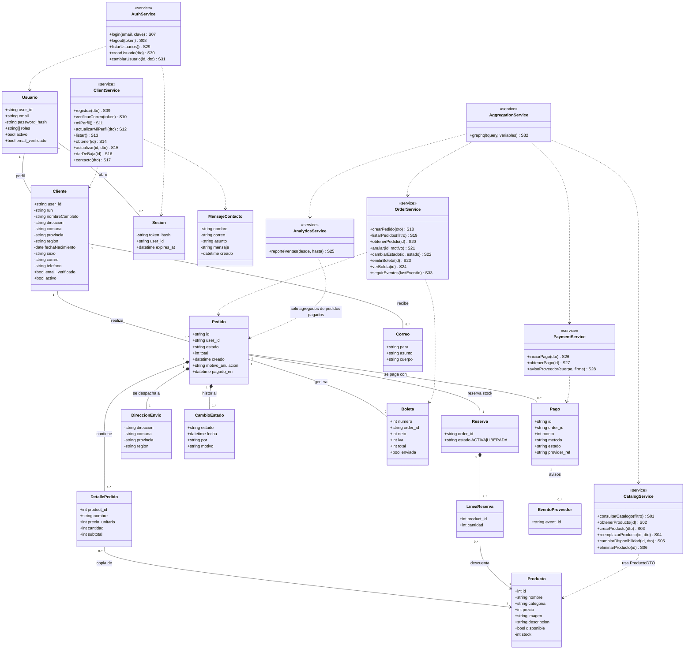
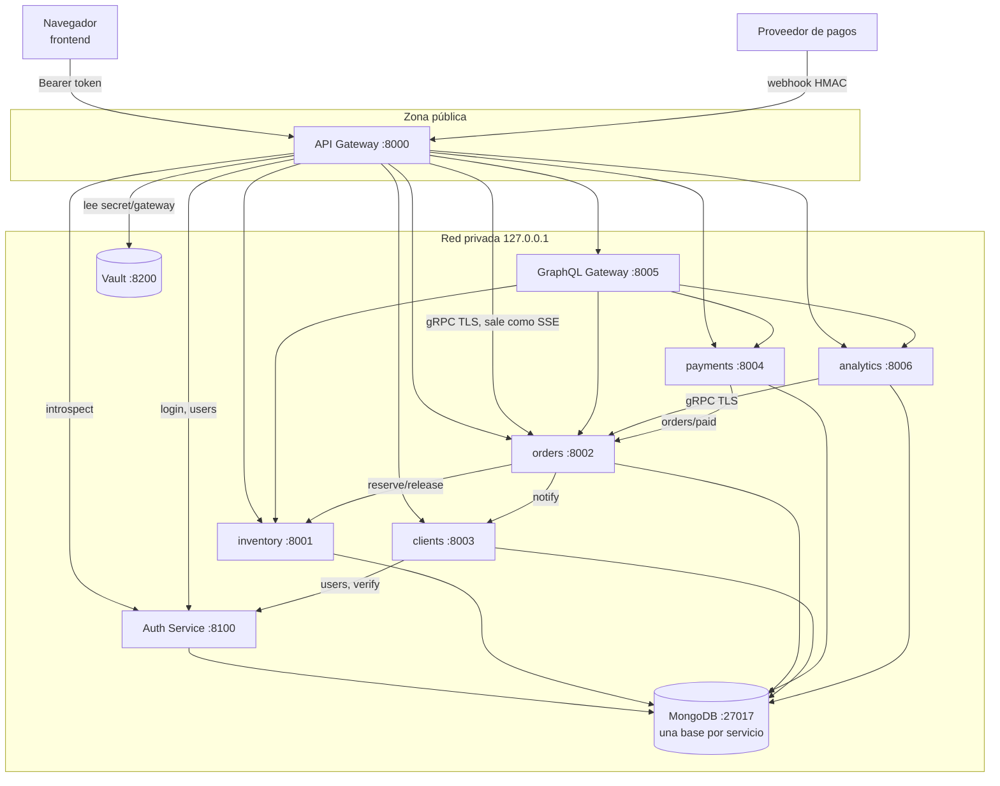
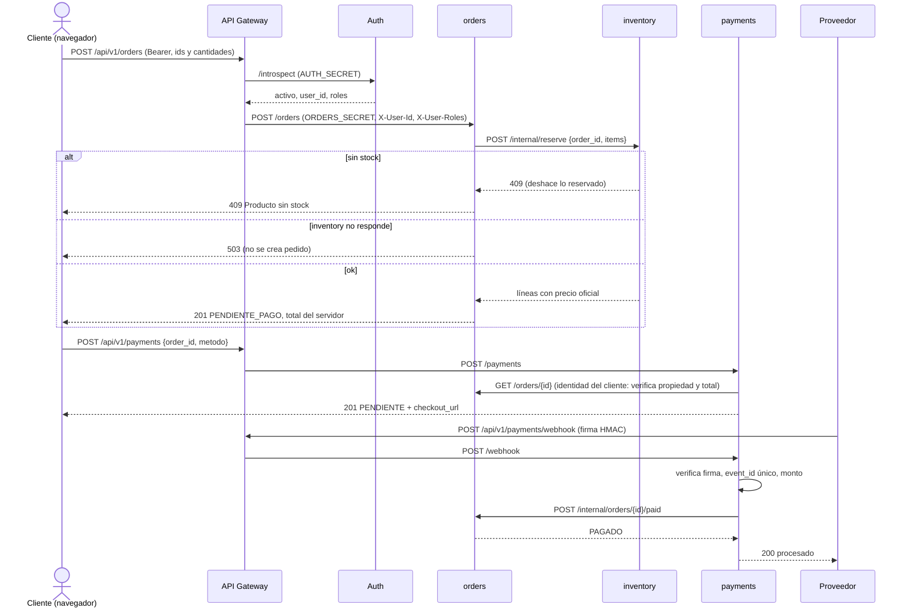
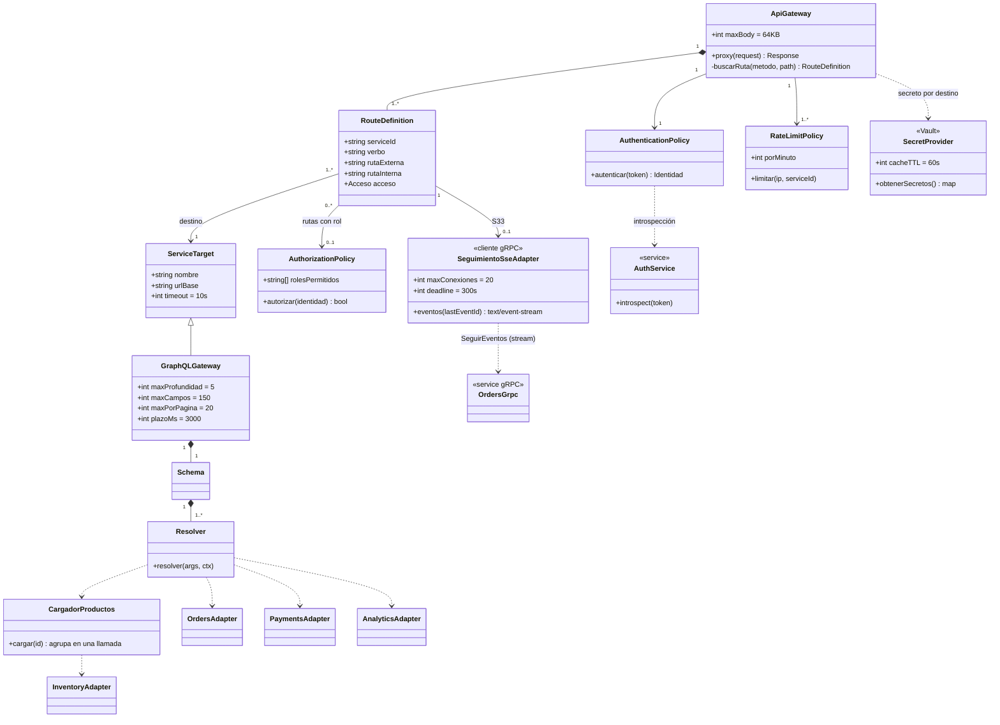

# Informe de arquitectura: backend seguro de "Frío Natural"

**Caso 3:** Heladería "Frío Natural", helados artesanales en envases y cucuruchos.
**Integrantes:** Benjamín Araya González y Jaime Ariza. **NRC:** 8479.
**Versión del frontend:** la entregada en la Solemne 1.

---

## Índice

- [Introducción](#introducción)
- [Punto de partida](#punto-de-partida)
  - [Requisitos del caso](#requisitos-del-caso)
  - [Pantallas existentes](#pantallas-existentes)
  - [Datos tomados del frontend](#datos-tomados-del-frontend)
  - [Brechas declaradas](#brechas-declaradas)
- [Módulo 1. Servicios derivados del frontend](#módulo-1-servicios-derivados-del-frontend)
- [Módulo 2. Clases y cardinalidades del dominio](#módulo-2-clases-y-cardinalidades-del-dominio)
- [Módulo 3. Sistemas e integraciones](#módulo-3-sistemas-e-integraciones)
  - [Mapa de componentes](#mapa-de-componentes)
  - [Secuencia: compra completa](#secuencia-compra-completa)
- [Módulo 4. Stakeholders y permisos HTTP](#módulo-4-stakeholders-y-permisos-http)
  - [Verbos por servicio](#verbos-por-servicio)
  - [Matriz de permisos](#matriz-de-permisos)
- [Módulo 5. Clases del API Gateway](#módulo-5-clases-del-api-gateway)
  - [Fronteras de confianza](#fronteras-de-confianza)
- [Módulo 6. Rutas y secretos de integración](#módulo-6-rutas-y-secretos-de-integración)
  - [Matriz de rutas](#matriz-de-rutas)
  - [Inventario de secretos e identidades](#inventario-de-secretos-e-identidades)
- [Módulo 7. Datos sensibles y secretos del cliente](#módulo-7-datos-sensibles-y-secretos-del-cliente)
- [Módulo 8. Separación privada y agregaciones GraphQL](#módulo-8-separación-privada-y-agregaciones-graphql)
  - [Schema GraphQL](#schema-graphql)
  - [Resolvers](#resolvers)
  - [Controles](#controles)
- [Módulo 9. Analítica y comunicación gRPC](#módulo-9-analítica-y-comunicación-grpc)
  - [ADR-01: servicio de analítica separado](#adr-01-servicio-de-analítica-separado)
  - [ADR-02: comunicación interna gRPC](#adr-02-comunicación-interna-grpc)
  - [Prueba de carga](#prueba-de-carga)
- [Módulo 10. Backend completo e integración verificable](#módulo-10-backend-completo-e-integración-verificable)
  - [Matriz de trazabilidad](#matriz-de-trazabilidad)
  - [Limitaciones declaradas](#limitaciones-declaradas)
- Anexos
  - [Anexo A. Ejemplos de contrato de los 33 servicios](CONTRATOS.md)
  - [Anexo B. Cómo probar el backend](#anexo-b-cómo-probar-el-backend)

---

## Introducción

Este informe documenta el backend que construimos para la heladería "Frío Natural" a partir del frontend que
entregamos en la Solemne 1. El objetivo fue pasar de un sitio estático a un sistema con servicios reales para
gestionar el catálogo, los clientes, los pedidos, los pagos y el despacho, cuidando la seguridad en cada punto donde
entran datos o se cruzan servicios.

El backend se divide en servicios pequeños, cada uno con su propia base MongoDB: autenticación, clientes,
inventario, pedidos, pagos y analítica. Todo el tráfico externo pasa por un API Gateway que valida la sesión,
aplica los permisos por rol y obtiene sus credenciales desde Vault. Las lecturas que combinan datos de varios
servicios se resuelven con un gateway GraphQL, y el seguimiento de pedidos para despacho viaja por gRPC con TLS.
El funcionamiento se comprueba con 41 pruebas automáticas (`pytest`), una colección de Postman y una prueba de
carga.

La entrega se construye con los datos del frontend y no con el frontend integrado: las pantallas, los formularios y
el catálogo del frontend de la Solemne 1 definen los servicios, los contratos y los datos iniciales del backend, y las pruebas se
hacen directamente contra el API Gateway.

---

## Punto de partida

### Requisitos del caso

El caso 3 sigue el mismo modelo de negocio del caso de referencia (Caso 19): un local pequeño que suma venta web
con despacho. La tabla resume los requisitos funcionales (RF) que tomamos del caso. Son requisitos del negocio;
las decisiones de arquitectura que tomamos para cumplirlos se explican y justifican en cada módulo y en los ADR del
Módulo 9.

| RF | Requisito |
|---|---|
| RF1 | El cliente arma un pedido con los productos disponibles de la carta. |
| RF2 | El pedido se prepara solo después de confirmado el pago. |
| RF3 | El cliente puede anular una compra indicando el motivo. |
| RF4 | Las ventas se asocian a un cajero virtual (funcionario) y solo a clientes registrados. |
| RF5 | Registro de clientes (RUN, nombre, dirección, comuna, provincia, región, fecha de nacimiento, sexo, correo, teléfono) con validación real del correo. |
| RF6 | El registro lo puede hacer el cliente en la web o el administrador en el local. |
| RF7 | Consultar y actualizar la disponibilidad de los productos. |
| RF8 | Emitir una boleta digital por venta y enviarla al correo del cliente. |
| RF9 | Reporte de ventas por período para el dueño. |
| RF10 | Mantenedores de productos, usuarios y clientes. |
| RF11 | Validación del correo mediante una API de mensajería. |
| RF12 | Autenticación y acceso según el perfil que asigna el administrador. |
| RF13 | Órdenes de despacho en orden de llegada para el encargado de despacho. |
| RF14 | Pago en una plataforma externa (Webpay, Onepay o transferencia, como en `pago.html`). |
| RF15 | Formulario de contacto (`contacto.html`). |

### Pantallas existentes

| ID | Pantalla | Acciones |
|---|---|---|
| P01 | `index.html` | Navegación |
| P02 | `carta.html` / `pedidos_online.html` | Cargar catálogo, agregar al carrito |
| P03 | `carrito.html` | Ver carrito, datos de envío, pasar a pago |
| P04 | `pago.html` | Elegir medio de pago y pagar |
| P05 | `registrarse.html` | Registro de cliente |
| P06 | `iniciar_sesion.html` | Login |
| P07 | `contacto.html` | Enviar mensaje |
| P08 | `locales.html`, `sobre_nosotros.html` | Contenido estático, **no requiere servicio** |

Escritorio y móvil son la misma pantalla responsiva (Bootstrap), así que no generan servicios distintos.

### Datos tomados del frontend

El backend usa los mismos datos que maneja el frontend. El catálogo se cargó tal cual desde `productos.js`, y los
campos de cada formulario pasaron a ser la entrada de su servicio.

| Dato | Origen en el frontend | Uso en el backend |
|---|---|---|
| Catálogo: 7 productos con id, nombre, categoría, precio e imagen | `productos.js` | Datos iniciales de inventory (`seed.py`), con los mismos valores; se agregan descripción, disponibilidad y stock, que el frontend no tenía (S01, S02) |
| Carrito: id del producto y cantidad | `carrito.js` | `items` de S18; el precio y el total los calcula el servidor y no se toman del navegador |
| Envío: dirección, comuna, provincia y región | `carrito.html` | `envio` de S18 |
| Registro: nombre, RUN, dirección, comuna, provincia, región, fecha de nacimiento, sexo, correo, teléfono y clave | `registrarse.html` | Entrada de S09; la repetición de la clave solo se revisa en el navegador |
| Inicio de sesión: correo y clave | `iniciar_sesion.html` | Entrada de S07 |
| Medio de pago: Webpay, Onepay o transferencia bancaria | `pago.html` | `metodo` de S26 |
| Contacto: nombre, correo, asunto y mensaje | `contacto.html` | Entrada de S17 |

### Brechas declaradas

Algunas funciones del caso todavía no tienen pantalla en el frontend. Sus servicios ya están implementados y
probados en el backend; lo que falta es la pantalla, y la última columna propone cómo se incorporaría cada una.

| Brecha | Servicio que la resuelve | Cómo se incorporará |
|---|---|---|
| P09 Verificar correo | S10 | Pantalla que pide el código recibido por correo |
| P10 Mi perfil | S11, S12 | Página "Mi cuenta" |
| P11 Mis pedidos / anular | S19–S21, G01, G02 | Página "Mis pedidos" que consulta GraphQL |
| P12 Panel admin (productos, clientes, usuarios) | S03–S06, S13–S16, S29–S31 | Páginas de administración |
| P13 Panel despacho | S19, S22, S33 | Lista de órdenes pagadas en orden de llegada, actualizada en vivo (SSE) |
| P14 Panel cajero (boletas) | S23, S24 | Botón "emitir boleta" en los pedidos pagados |
| P15 Reporte de ventas | S25, G03 | Página del dueño con selector de período |

---

## Módulo 1. Servicios derivados del frontend

Recorrimos cada pantalla y anotamos qué operación necesita. Cuando varias pantallas hacen lo mismo usan el mismo
servicio (por ejemplo, S19 sirve tanto a "Mis pedidos" como al panel de despacho).

Acceso: **A** = anónimo, **S** = con sesión (cualquier rol) o los roles indicados. Datos: **Púb** = público,
**Per** = dato personal restringido, **Cred** = credencial, **Int** = dato interno.

| ID | RF | Pantalla → acción | Propósito | Verbo y ruta | Entrada | Salida | Reglas y errores | Datos | Acceso |
|---|---|---|---|---|---|---|---|---|---|
| S01 | RF1, RF7 | P02 → cargar catálogo | Mostrar la carta | GET /api/v1/products?available&categoria | Query opcional | 200 lista {id,nombre,categoria,precio,imagen,descripcion,disponible} | 422 filtro inválido; el stock solo lo ven admin y dueño | Púb (stock Int) | A |
| S02 | RF1 | P02 → ver producto | Detalle de un producto | GET /api/v1/products/{id} | id | 200 producto | 404 | Púb | A |
| S03 | RF10 | P12 → crear producto | Ampliar la carta | POST /api/v1/products | {nombre,categoria,precio,imagen,descripcion,disponible,stock} | 201 producto | 422 validación | Púb/Int | admin |
| S04 | RF10 | P12 → editar producto | Corregir un producto | PUT /api/v1/products/{id} | Representación completa | 200 | 404, 422 | Púb/Int | admin |
| S05 | RF7 | P12 → disponibilidad | Marcar agotado o reponer | PATCH /api/v1/products/{id}/availability | {disponible, stock?} | 200 | 404 | Int | admin, dueno |
| S06 | RF10 | P12 → eliminar producto | Sacar un producto de la carta | DELETE /api/v1/products/{id} | — | 204 | 404; el historial guarda su copia | — | admin |
| S07 | RF12 | P06 → login | Abrir sesión | POST /api/v1/auth/login | {email,password} | 200 {access_token,expires_in,roles} | 401 genérico; 403 sin verificar o deshabilitado; 429 | Cred | A |
| S08 | RF12 | Todas → cerrar sesión | Revocar el token | POST /api/v1/auth/logout | Bearer | 200 | 401 | Cred | S |
| S09 | RF5, RF6 | P05 → registrarse | Crear cuenta de cliente | POST /api/v1/clients | {nombreCompleto,run,direccion,comuna,provincia,region,fechaNacimiento,sexo,correo,telefono,clave} | 201 {user_id,correo,email_verificado:false} | 422 RUN, correo o teléfono inválido; 409 duplicado | Per + Cred | A (o admin) |
| S10 | RF5, RF11 | P09 → verificar correo | Activar la cuenta | POST /api/v1/clients/verify-email | {token} | 200 | 400 código inválido | Cred temporal | A |
| S11 | RF5 | P10 → ver perfil | Ver mis datos | GET /api/v1/clients/me | Bearer | 200 perfil propio | 404 | Per | cliente |
| S12 | RF5 | P10 → editar perfil | Actualizar mis datos | PUT /api/v1/clients/me | Perfil sin run, correo ni clave | 200 | 422 | Per | cliente |
| S13 | RF10 | P12 → listar clientes | Mantenedor de clientes | GET /api/v1/clients?skip&limit | Paginación | 200 lista | — | Per | admin |
| S14 | RF10 | P12 → ver cliente | Revisar un cliente | GET /api/v1/clients/{id} | — | 200 | 404 | Per | admin |
| S15 | RF10 | P12 → editar cliente | Corregir datos en el local | PUT /api/v1/clients/{id} | Perfil | 200 | 404, 422 | Per | admin |
| S16 | RF10 | P12 → dar de baja | Deshabilitar una cuenta | DELETE /api/v1/clients/{id} | — | 204 (baja lógica) | 404 | Per | admin |
| S17 | RF15 | P07 → enviar mensaje | Contacto con el local | POST /api/v1/contact | {nombre,correo,asunto,mensaje} | 201 | 422 | Per | A |
| S18 | RF1, RF4 | P03/P04 → confirmar pedido | Crear el pedido | POST /api/v1/orders | {items:[{product_id,cantidad}], envio} | 201 pedido PENDIENTE_PAGO con precios y total calculados por el servidor | 409 sin stock; 503 inventory caído | Per (envío) | cliente |
| S19 | RF1, RF13 | P11/P13 → listar pedidos | Historial o cola de despacho | GET /api/v1/orders?estado&skip&limit | — | 200 {total,pedidos} | El cliente ve solo los suyos | Per | S |
| S20 | RF1 | P11 → ver pedido | Detalle del pedido | GET /api/v1/orders/{id} | — | 200 | 404 si no existe **o es ajeno** | Per | S |
| S21 | RF3 | P11 → anular | Anular con motivo | POST /api/v1/orders/{id}/cancel | {motivo} | 200 ANULADO | 409 estado no anulable | Per | cliente, admin |
| S22 | RF2, RF13 | P13 → avanzar estado | Preparar, despachar, entregar | PATCH /api/v1/orders/{id}/status | {estado} | 200 | 409 transición inválida | Int | despacho, admin |
| S23 | RF8 | P14 → emitir boleta | Boleta y envío por correo | POST /api/v1/orders/{id}/receipt | — | 201 boleta (idempotente) | 409 no pagado | Per | cajero, admin |
| S24 | RF8 | P11 → ver boleta | Consultar la boleta | GET /api/v1/orders/{id}/receipt | — | 200 | 404 | Per | S |
| S25 | RF9 | P15 → reporte | Ventas del período | GET /api/v1/reports/sales?desde&hasta | Fechas ISO | 200 totales y venta por producto | 400 período mayor a 1 año | Int | dueno, admin |
| S26 | RF14 | P04 → pagar | Iniciar el cobro | POST /api/v1/payments | {order_id, metodo} | 201 {id,monto,estado:PENDIENTE,checkout_url}; un reintento devuelve el mismo pago | 404 pedido ajeno; 409 no pendiente | Int | cliente |
| S27 | RF14 | P11 → ver pago | Estado del cobro | GET /api/v1/payments/{id} | — | 200 | 404 si es ajeno | Int | S |
| S28 | RF14, RF2 | (proveedor) → aviso de pago | Confirmar o rechazar el cobro | POST /api/v1/payments/webhook | Cuerpo firmado + X-Provider-Signature | 200 | 401 firma; 400 mal formado; 503 orders caído (el proveedor reintenta); duplicado sin efectos | Int | A + HMAC |
| S29 | RF10, RF12 | P12 → listar usuarios | Ver cuentas del personal | GET /api/v1/admin/users | — | 200 sin hash | — | Cred (sin hash) | admin |
| S30 | RF10, RF12 | P12 → crear usuario | Alta de personal | POST /api/v1/admin/users | {email,password,roles} | 201 | 409; 400 rol inválido | Cred | admin |
| S31 | RF12 | P12 → asignar perfil | Cambiar roles o desactivar | PUT /api/v1/admin/users/{id} | {roles,activo} | 200 (revoca sus sesiones) | 404 | Cred | admin |
| S32 | RF1, RF9 | P11/P15 → agregaciones | Lecturas combinadas | POST /api/v1/graphql | {query,variables} | Ver Módulo 8 | Autorización por operación y campo | Mixto | S |
| S33 | RF2, RF13 | P13 → pedidos nuevos en vivo | Avisar a despacho sin recargar | GET /api/v1/dispatch/events | `Last-Event-ID` opcional | 200 `text/event-stream` con `id: seq` y `data: {order_id,estado,fecha,total,items}` | 400 Last-Event-ID inválido; 503 seguimiento caído o más de 20 conexiones | Int (sin dirección ni cliente) | despacho, admin |

**Cabeceras.** Las rutas con sesión exigen `Authorization: Bearer <token>`. S28 exige `X-Provider-Signature` y S33
acepta `Last-Event-ID`. `X-Correlation-Id` es opcional: si no viene o no tiene un formato válido, el gateway genera
uno y lo devuelve en la respuesta.

**Campos de entrada y validación en el servidor.** Todo se valida con Pydantic en el servicio dueño del dato. Los
campos que no están en el contrato (por ejemplo `precio` o `total` en S18) se ignoran.

| Servicio | Campo | Tipo | Oblig. | Validación | Clasificación |
|---|---|---|---|---|---|
| S01 | `available`, `categoria` | Query bool, string | No | Booleano; categoría ≤ 40 | Púb |
| S03, S04 | `nombre`, `categoria` | string | Sí | 1–80 y 1–40 caracteres | Púb |
| S03, S04 | `precio` | int (CLP) | Sí | 1 a 1.000.000 | Púb |
| S03, S04 | `imagen`, `descripcion` | string | No | ≤ 500 | Púb |
| S03–S05 | `disponible`, `stock` | bool, int | Sí (stock opcional en S05) | stock 0 a 100.000 | Púb / Int |
| S07 | `email`, `password` | string | Sí | Formato de correo ≤ 120; clave 1–128 | Per / Cred |
| S09, S12, S15 | `nombreCompleto`, `direccion` | string | Sí | 1–100 y 1–150 | Per |
| S09, S12, S15 | `comuna`, `provincia`, `region` | string | Sí | 1–60 | Per |
| S09, S12, S15 | `fechaNacimiento`, `sexo` | date ISO, enum | Sí | Fecha válida; `Femenino`, `Masculino` o `Prefiero no decirlo` | Per |
| S09, S12, S15 | `telefono` | string | Sí | `^\+?\d[\d\s]{7,14}$` | Per |
| S09 | `run` | string | Sí | ≤ 12, dígito verificador con el mismo algoritmo que `validarRut()` del frontend, único | Per |
| S09 | `correo`, `clave` | string | Sí | Formato de correo, único; clave 6–128 | Per / Cred |
| S10 | `token` | string | Sí | 10–100 | Cred temporal |
| S13, S19 | `skip`, `limit` | Query int | No | skip ≥ 0; limit 1–200 (clientes) y 1–100 (pedidos) | — |
| S17 | `nombre`, `correo`, `asunto`, `mensaje` | string | Sí | 1–100, correo, 1–120, 1–2000 | Per |
| S18 | `items[]` | Lista de {`product_id` int, `cantidad` int} | Sí | 1 a 20 líneas; cantidad 1–50 | Púb |
| S18 | `envio` | {direccion, comuna, provincia, region} | Sí | Mismos largos que el perfil | Per |
| S21 | `motivo` | string | Sí | 5–300 | Per |
| S22 | `estado` | enum | Sí | `EN_PREPARACION`, `DESPACHADO` o `ENTREGADO` | Int |
| S25 | `desde`, `hasta` | Query fecha ISO | Sí | desde ≤ hasta; máximo un año | Int |
| S26 | `order_id`, `metodo` | string, enum | Sí | id 1–40; `Webpay`, `Onepay` o `Transferencia bancaria` | Int |
| S28 | `event_id`, `provider_ref`, `estado`, `monto` | string, string, enum, int | Sí | 1–80, 1–80, `APROBADO`/`RECHAZADO`, monto igual al del pedido | Int |
| S30 | `email`, `password`, `roles` | string, string, lista | Sí | correo; clave 6–128; roles dentro de {cliente, admin, dueno, cajero, despacho} | Cred |
| S31 | `roles`, `activo` | Lista, bool | Sí | Al menos un rol válido | Cred |

**Lo que calcula el servidor.** El precio unitario, el subtotal, el total, el estado del pedido, el monto y el
estado del pago, el número de boleta, el IVA, el `user_id` y los roles nunca se aceptan desde el navegador.

### Ejemplos de contrato

Cada servicio tiene su ejemplo JSON con datos ficticios en el [Anexo A](CONTRATOS.md). Los ejemplos se
obtuvieron ejecutando cada contrato contra el backend e incluyen sus errores principales. Este es el de S18; si el
navegador agrega `precio` o `total`, el servidor los ignora:
```json
{"items": [{"product_id": 1, "cantidad": 2}, {"product_id": 3, "cantidad": 1}],
 "envio": {"direccion": "Av. Pajaritos 1234", "comuna": "Maipú", "provincia": "Santiago", "region": "Metropolitana"}}
→ 201 {"id": "PED-000001", "estado": "PENDIENTE_PAGO", "total": 12200, "items": [...], "envio": {...}, "historial": [...]}
→ 409 {"detail": "Producto 5 sin stock o no disponible"}
```

---

## Módulo 2. Clases y cardinalidades del dominio



**Leyenda.** `--` es asociación, `*--` composición y `-->` asociación navegable.
`..>` es una dependencia de uso: el servicio usa la clase o su DTO, pero **no** representa una relación entre
registros. Un atributo con `-` es interno y no sale en el DTO público; uno con `+` puede salir en alguna respuesta,
según el rol. `MensajeContacto` no se asocia a `Cliente` porque el formulario de contacto lo puede enviar un
visitante sin cuenta.

| Origen | Destino | Multiplicidad | Regla de negocio |
|---|---|---|---|
| Usuario | Sesion | 1 — 0..* | Un usuario puede tener sesiones abiertas en varios dispositivos; cada sesión pertenece a un solo usuario. |
| Usuario | Cliente | 1 — 0..1 | El personal (admin, cajero, etc.) no tiene perfil de cliente; cada cliente tiene exactamente una credencial. |
| Cliente | Pedido | 1 — 0..* | Un cliente registrado puede no haber comprado nunca; cada pedido pertenece a un solo cliente (RF4). |
| Pedido | DetallePedido | 1 — 1..* | No hay pedidos vacíos: el carrito vive en el navegador y el pedido se crea al confirmar con al menos un ítem. |
| Pedido | DireccionEnvio | 1 — 1 | Todo pedido web lleva despacho, y se guarda una copia de la dirección usada. |
| Pedido | CambioEstado | 1 — 1..* | Siempre queda registrada al menos la creación; la anulación agrega su motivo (RF3). |
| DetallePedido | Producto | 0..* — 1 | Cada línea se refiere a un producto, pero guarda una copia de su nombre y precio: si el producto cambia o se elimina, el historial no cambia. |
| Pedido | Reserva | 1 — 1 | Al crear el pedido se reserva su stock, y la anulación lo libera una sola vez. |
| Reserva | LineaReserva | 1 — 1..* | Se reserva una línea por cada producto distinto del pedido. |
| LineaReserva | Producto | 0..* — 1 | Un producto puede estar en reservas de muchos pedidos; cada línea descuenta stock de un solo producto. |
| Pedido | Boleta | 1 — 0..1 | La boleta existe solo si el pedido fue pagado, y es única (la emisión es idempotente). |
| Pedido | Pago | 1 — 0..* | Si un pago es rechazado se puede intentar otro. Un índice único parcial permite un solo pago PENDIENTE por pedido, incluso con solicitudes simultáneas. |
| Pago | EventoProveedor | 1 — 0..* | El proveedor puede reenviar el mismo aviso; como `event_id` es único, no se procesa dos veces. |
| Cliente | Correo | 1 — 0..* | Un cliente recibe el código de verificación y una boleta por cada compra; cada correo va a un solo cliente. |

**Decisiones.** El carrito y el pedido son clases distintas: el carrito es estado del navegador y no tiene valor
para el negocio hasta que se confirma. Si un producto deja de estar disponible, el historial no se pierde gracias a
la copia guardada en `DetallePedido`. Separamos el modelo interno de los DTO: el producto público no incluye
`stock`, el pedido no incluye `user_id` para los clientes ni `envio` para el cajero y el dueño, y el usuario nunca
incluye `password_hash`.

---

## Módulo 3. Sistemas e integraciones

| Sistema | Responsabilidad | Datos que administra (autoridad) | Servicios | Depende de | Contrato de integración | Credencial requerida | Respuesta ante fallos |
|---|---|---|---|---|---|---|---|
| inventory | Catálogo, disponibilidad, stock y reservas | `products`, `reservations` | S01–S06 | — | `POST /internal/reserve` {order_id, items} → líneas con el precio oficial; `POST /internal/release/{order_id}` | `INVENTORY_SECRET` | Reserva atómica por ítem, que se deshace si falla una línea; idempotente por order_id |
| orders | Pedidos, ciclo de vida, boletas, despacho y eventos de estado | `orders`, `receipts`, `counters`, `events` | S18–S24, S33 | inventory, clients | `POST /internal/orders/{id}/paid` {payment_id, monto}; gRPC `Seguimiento` (TLS) | `ORDERS_SECRET`, `GRPC_*_SECRET`, certificado TLS | Si inventory no responde, 503 y el pedido no se crea. Si cae al anular, la anulación se confirma igual, el pedido queda con `stock_por_liberar` y orders reintenta cada 5 s. Si falla el correo, la boleta queda con `enviada:false` y al emitirla de nuevo se reintenta |
| clients | Registro, perfil, verificación de correo, contacto y mensajería | `clients`, `outbox`, `contact_messages` | S09–S17 | auth | `POST /internal/notify` {user_id, asunto, cuerpo} | `CLIENTS_SECRET` | Si auth no responde al registrar, se borra el perfil recién creado y responde 503 |
| payments | Inicio del pago y verificación del aviso del proveedor | `payments`, `webhook_events` | S26–S28 | orders, proveedor | Aviso del proveedor firmado con HMAC-SHA256 | `PAYMENTS_SECRET`, `PROVIDER_WEBHOOK_SECRET` | Si orders no responde, borra el evento y responde 503 para que el proveedor reintente |
| Auth Service | Credenciales, sesiones y roles | `users`, `sessions` | S07, S08, S29–S31 | — | `/introspect`, `/internal/users/{id}/verify` y `/disable` | `AUTH_SECRET` | El gateway responde 503 si no puede validar el token |
| analytics | Reporte de ventas, separado de las transacciones | `sales` (solo datos agregables), `checkpoint` | S25 | orders (stream gRPC) | `GET /reports/sales`; consume `SeguirEventos` | `ANALYTICS_SECRET`, `GRPC_ANALYTICS_SECRET` | Si orders cae, reintenta cada 1 s desde su checkpoint. Si cae analytics, las ventas siguen y el reporte se pone al día al volver |
| GraphQL Gateway | Agregaciones de lectura | Ninguno | S32 | orders, inventory, payments, analytics | GraphQL (Módulo 8) | `GRAPHQL_SECRET` | Errores parciales por campo |
| Proveedor de pagos (externo) | Cobro | — | — | — | Webhook firmado | `PROVIDER_WEBHOOK_SECRET` | Reintenta los avisos que no se confirmaron |
| Mensajería (externo) | Envío de correos | — | — | — | Adaptador `enviar_correo()` | — | Ver la limitación más abajo |

**Quién decide el estado oficial.** El stock lo decide inventory. El estado del pedido lo decide orders, y solo
payments, mediante una llamada interna, puede marcarlo como PAGADO. El estado del pago lo decide payments, y solo
después de recibir un aviso con firma válida. La identidad y los roles los decide Auth Service.

**Servicios propios y externos.** Todos los sistemas de la tabla son propios, salvo el proveedor de pagos y la API
de correo. Ninguno de los dos ofrece un entorno de prueba sin crear una cuenta, así que usamos **adaptadores de
prueba** que respetan el contrato, la autenticación y las transiciones. payments genera un `provider_ref` de prueba
y solo acepta avisos firmados con el secreto del proveedor (las pruebas firman igual que lo haría el proveedor). Los
correos se guardan en la colección `fn_clients.outbox`.

### Mapa de componentes



### Secuencia: compra completa



---

## Módulo 4. Stakeholders y permisos HTTP

| Stakeholder | Interés | Rol asociado | Uso de información |
|---|---|---|---|
| Cliente | Comprar helados con despacho | `cliente` | Catálogo, sus pedidos, pagos, boletas y perfil |
| Visitante | Ver la carta | Anónimo | Catálogo público, registro y contacto |
| Administrador | Operar el sistema | `admin` | Mantenedores, anulaciones y asignación de perfiles |
| Dueño | Rentabilidad del local | `dueno` | Reporte de ventas y disponibilidad |
| Cajero virtual (funcionario) | Vender y emitir boletas | `cajero` | Pedidos pagados y boletas |
| Encargado de despacho | Preparar y entregar | `despacho` | Órdenes pagadas en orden de llegada, con dirección |
| Proveedor de pagos | Informar cobros | Identidad técnica (HMAC) | Solo S28 |
| API Gateway, GraphQL y servicios | Integración | Identidades técnicas (un secreto por destino) | Llamadas internas |
| Cocina | Preparar pedidos | **sin permisos operativos** | Recibe la orden que imprime despacho (RF13) |
| Choferes | Entregar | **sin permisos operativos** | Reciben de despacho la orden con la dirección |
| Proveedores de leche y fruta | Abastecer | **sin permisos operativos** | El dueño les comunica lo que se necesita a partir del reporte |

Separamos tres cosas: las partes interesadas (la tabla de arriba), los roles de usuario (`cliente`, `admin`,
`dueno`, `cajero`, `despacho`) y las identidades técnicas (el proveedor y los servicios internos, que se identifican
con una firma o un secreto y no con una sesión de usuario).

### Verbos por servicio

Cada celda indica qué roles pueden usar el verbo; **Denegado** = nadie puede usarlo; — = no aplica (la ruta no existe). Que un verbo
esté permitido no autoriza todas las rutas: cada fila es un recurso concreto.

| Recurso | GET | POST | PUT | PATCH | DELETE |
|---|---|---|---|---|---|
| `/products`, `/products/{id}` (S01–S04, S06) | Todos | admin | admin | — | admin |
| `/products/{id}/availability` (S05) | — | — | — | admin, dueno | — |
| `/auth/login`, `/auth/logout` (S07, S08) | — | Anónimo / sesión | — | — | — |
| `/clients` (S09, S13) | admin | Anónimo, admin | — | — | — |
| `/clients/me` (S11, S12) | cliente | — | cliente | — | — |
| `/clients/{id}` (S14–S16) | admin | — | admin | — | admin (baja lógica) |
| `/clients/verify-email`, `/contact` (S10, S17) | — | Anónimo | — | — | — |
| `/orders` (S18, S19) | Sesión (filtrado por rol) | cliente | — | — | — |
| `/orders/{id}` (S20) | Dueño del pedido y personal | — | Denegado | — | Denegado (405, no se borran pedidos) |
| `/orders/{id}/cancel` (S21) | — | cliente propio, admin | — | — | — |
| `/orders/{id}/status` (S22) | — | — | — | despacho, admin | — |
| `/orders/{id}/receipt` (S23, S24) | Dueño del pedido y personal | cajero, admin | — | — | — |
| `/reports/sales` (S25) | dueno, admin | — | — | — | — |
| `/payments`, `/payments/{id}` (S26, S27) | Dueño del pago y personal | cliente | — | — | — |
| `/payments/webhook` (S28) | — | Proveedor con firma | — | — | — |
| `/admin/users`, `/admin/users/{id}` (S29–S31) | admin | admin | admin | — | — |
| `/graphql` (S32) | — | Sesión (autorización por operación y campo) | — | — | — |
| `/dispatch/events` (S33) | despacho, admin | — | — | — | — |

Usamos PUT cuando se reemplaza la representación completa (producto, perfil, usuario) y PATCH cuando se cambia un
solo aspecto con reglas propias: la disponibilidad de un producto (S05) y el estado de un pedido (S22). Anular no es
borrar: S21 es un POST que deja el pedido en ANULADO con su motivo y conserva el historial.

### Matriz de permisos

Dónde se verifica: **GW** = en el gateway (rol por ruta); **Srv** = en el servicio dueño del recurso (rol,
propiedad y estado). Ocultar un botón en el frontend no reemplaza ninguna de estas verificaciones.

| Rol / identidad | Servicio | Ruta | Verbo | Decisión | Alcance y condición | Verifica |
|---|---|---|---|---|---|---|
| Visitante | S01, S02 | /products[/{id}] | GET | Permitido | Solo campos públicos | Srv |
| Visitante | S03–S06 | /products… | POST/PUT/PATCH/DELETE | Denegado (401) | — | GW |
| Visitante | S07, S09, S10, S17 | Login, registro, verificación, contacto | POST | Permitido | Máximo 20 (login) y 10 (registro) solicitudes por minuto por IP | GW |
| Visitante | S18–S27 | Pedidos, pagos | Todos | Denegado (401) | — | GW |
| Cliente | S11, S12 | /clients/me | GET, PUT | Permitido | Solo su propio perfil (user_id del token) | Srv |
| Cliente | S13–S16 | /clients, /clients/{id} | Todos | Denegado (403) | — | GW |
| Cliente | S18 | /orders | POST | Permitido | Precios y total los pone el servidor | Srv |
| Cliente | S19, S20 | /orders, /orders/{id} | GET | Permitido | Solo pedidos propios; uno ajeno da 404 sin datos | Srv |
| Cliente | S21 | /orders/{id}/cancel | POST | Permitido | Pedido propio en PENDIENTE_PAGO o PAGADO | Srv |
| Cliente | S22 | /orders/{id}/status | PATCH | Denegado (403) | — | GW |
| Cliente | S23 | /orders/{id}/receipt | POST | Denegado (403) | — | GW |
| Cliente | S24 | /orders/{id}/receipt | GET | Permitido | Solo de un pedido propio | Srv |
| Cliente | S26 | /payments | POST | Permitido | Pedido propio en PENDIENTE_PAGO; el monto lo da orders | Srv |
| Cliente | S27 | /payments/{id} | GET | Permitido | Solo pagos propios | Srv |
| Cliente | S03–S06, S25, S29–S31 | Administración | Todos | Denegado (403) | Ver el catálogo no da permisos de administración | GW |
| Admin | S03–S06, S13–S16, S29–S31 | Mantenedores | Todos | Permitido | No puede quitarse a sí mismo el rol admin | GW + Srv |
| Admin | S21 | cancel | POST | Permitido | Hasta EN_PREPARACION | Srv |
| Dueño | S05 | availability | PATCH | Permitido | Solo disponibilidad y stock | GW + Srv |
| Dueño | S25, G03 | Reporte | GET / Query | Permitido | Agregados, sin datos personales | GW + Srv |
| Cajero | S19, S20 | Pedidos | GET | Permitido | Todos los pedidos, **sin dirección** | Srv |
| Cajero | S23 | receipt | POST | Permitido | Pedido pagado; una boleta por pedido | Srv |
| Despacho | S19, S20 | Pedidos | GET | Permitido | En orden de llegada, con dirección | Srv |
| Despacho | S22 | status | PATCH | Permitido | Solo PAGADO → EN_PREPARACION → DESPACHADO → ENTREGADO | Srv |
| Despacho, Admin | S33 | /dispatch/events | GET | Permitido | Eventos de estado sin cliente ni dirección | GW |
| Cliente, Cajero, Dueño | S33 | /dispatch/events | GET | Denegado (403) | — | GW |
| Proveedor | S28 | /payments/webhook | POST | Permitido | Solo con firma HMAC válida | Srv (payments) |
| Cualquier rol | — | DELETE /orders/{id} | DELETE | Denegado (405) | No existe borrado de pedidos: la anulación conserva el historial | GW |

La identidad la establece el gateway al validar el token con Auth Service; la autorización sobre un recurso la
decide el servicio dueño. Así, la matriz permite comprobar que un cliente no puede leer pedidos de otro: el gateway
deja pasar a cualquier sesión hacia S20, pero orders compara el `user_id` y responde 404
(`test_pedido_ajeno_no_se_entrega`).

---

## Módulo 5. Clases del API Gateway

Usamos **un solo API Gateway**. Todas las rutas externas las usan los mismos clientes (el frontend y el proveedor
de pagos) y se separan por política dentro de la tabla de rutas; un segundo gateway público no daría más
aislamiento en este caso. El **GraphQL Gateway** es un componente aparte y privado, al que solo llega el API
Gateway.



Las líneas continuas son relaciones estructurales (composición, herencia y asociaciones con multiplicidad). Las
punteadas son dependencias de comunicación, es decir, llamadas por la red, y no relaciones entre objetos guardados.
El diagrama separa la configuración (`RouteDefinition`, `ServiceTarget`), las políticas (`AuthenticationPolicy`,
`AuthorizationPolicy`, `RateLimitPolicy`) y los secretos (`SecretProvider`).

### Fronteras de confianza

1. **De Internet al API Gateway.** Nada que llega es confiable. El gateway revisa que la ruta y el verbo estén en
   su lista explícita (`RUTAS`, en el código del gateway), limita el tamaño del cuerpo y las solicitudes por IP,
   valida el token con Auth Service y comprueba el rol que exige la ruta. Las cabeceras hacia adentro se arman
   desde cero, así que un `X-User-Id` o `X-User-Roles` enviado por el navegador se descarta. La documentación
   automática de FastAPI (`/docs`, `/openapi.json`) está desactivada en todos los servicios.
2. **Del API Gateway a los servicios privados.** Cada destino exige su propio secreto en `X-Internal-Secret`. Sin
   él, una llamada directa recibe 403 aunque traiga cabeceras de identidad.
3. **Dentro de cada servicio.** Las reglas de negocio y de propiedad se vuelven a revisar, porque el gateway no
   sabe de quién es cada pedido. Los servicios no se fían del rol que informa el gateway para decidir sobre un
   recurso.

El gateway se encarga de la autenticación, del rol por ruta, de los límites, de los tiempos de espera, de devolver
errores sin trazas ni detalles internos y del identificador de correlación. Cada servicio valida el esquema de los
datos con Pydantic, la propiedad, el estado y las transiciones.

**Una solicitud autorizada.** Ana pide `GET /api/v1/orders/PED-000001`. El gateway encuentra la ruta S20 (requiere
sesión), valida el token y envía `X-User-Id: CLI-ANA`. orders comprueba que Ana es la dueña y responde 200.

**Dos solicitudes denegadas.** Pedro pide el mismo pedido con su token. El gateway lo deja pasar porque la ruta
solo pide sesión, pero orders ve que el `user_id` no coincide y responde **404 sin datos**
(`test_pedido_ajeno_no_se_entrega`). Si Ana agrega `X-User-Roles: admin` y pide `/reports/sales`, el gateway
descarta esa cabecera y responde **403** (`test_cabeceras_de_identidad_falsas_se_descartan`).

---

## Módulo 6. Rutas y secretos de integración

### Matriz de rutas

Todas las rutas pasan por el único gateway (GW) y se transforman de `/api/v1/<x>` a `<destino>/<x>`, salvo las que
se indican. Controles comunes a todas: tabla explícita de rutas, 120 solicitudes por minuto por IP, cuerpo de hasta
64 KB, tiempo de espera de 10 s, cabeceras de identidad reconstruidas y `X-Correlation-Id`.

| ID | Gateway | Verbo | Ruta externa | Acceso | Sistema y ruta destino | Controles adicionales | Credencial del tramo |
|---|---|---|---|---|---|---|---|
| S01 | GW | GET | /api/v1/products | A | inventory GET /products | Filtros validados, campos públicos | `secret/gateway#inventory` |
| S02 | GW | GET | /api/v1/products/{id} | A | inventory GET /products/{id} | id `[A-Za-z0-9_-]{1,40}` | `#inventory` |
| S03 | GW | POST | /api/v1/products | admin | inventory POST /products | Rol en GW y en el servicio | `#inventory` |
| S04 | GW | PUT | /api/v1/products/{id} | admin | inventory PUT /products/{id} | Ídem | `#inventory` |
| S05 | GW | PATCH | /api/v1/products/{id}/availability | admin, dueno | inventory PATCH …/availability | Ídem | `#inventory` |
| S06 | GW | DELETE | /api/v1/products/{id} | admin | inventory DELETE /products/{id} | Ídem | `#inventory` |
| S07 | GW | POST | /api/v1/auth/login | A | auth POST /login | 20/min por IP, mensaje genérico | `#auth` |
| S08 | GW | POST | /api/v1/auth/logout | S | auth POST /logout | El gateway envía el token de la propia sesión | `#auth` |
| S09 | GW | POST | /api/v1/clients | A | clients POST /clients | 10/min por IP | `#clients` |
| S10 | GW | POST | /api/v1/clients/verify-email | A | clients POST /clients/verify-email | Código en el cuerpo, no en la URL | `#clients` |
| S11–S16 | GW | GET/PUT/DELETE | /api/v1/clients… | Ver Módulo 4 | clients /clients… | Propiedad en el servicio | `#clients` |
| S17 | GW | POST | /api/v1/contact | A | clients POST /contact | — | `#clients` |
| S18–S24 | GW | Varios | /api/v1/orders… | Ver Módulo 4 | orders, mismas rutas | Propiedad y estado en el servicio | `#orders` |
| S25 | GW | GET | /api/v1/reports/sales | dueno, admin | analytics GET /reports/sales | Período ≤ 1 año | `#analytics` |
| S26, S27 | GW | POST/GET | /api/v1/payments… | cliente / S | payments, mismas rutas | Sin monto desde el navegador | `#payments` |
| S28 | GW | POST | /api/v1/payments/webhook | A + HMAC | payments POST /webhook | Solo se reenvía `X-Provider-Signature` | `#payments` + `secret/payments#provider_webhook_secret` |
| S29–S31 | GW | GET/POST/PUT | /api/v1/admin/users… | admin | auth /users… | Revoca sesiones al cambiar roles | `#auth` |
| S32 | GW | POST | /api/v1/graphql | S | GraphQL Gateway POST /graphql | Límites del Módulo 8 | `#graphql` |
| S33 | GW | GET | /api/v1/dispatch/events | despacho, admin | orders gRPC `Seguimiento/SeguirEventos`, adaptado a SSE | Hasta 20 conexiones, deadline 300 s, reanuda con `Last-Event-ID` | `#grpc_gateway` + TLS |
| — | GW | Cualquiera | `/internal/*`, `/introspect` y cualquier otra | — | **no publicadas** (404/405) | — | — |

**Llamadas internas.** Estas no salen al exterior. Distinguimos la credencial del usuario (su token, que solo
valida el gateway) de la credencial entre sistemas (el secreto de cada destino). Cuando un servicio necesita
comprobar la propiedad de un recurso, el llamador reenvía la identidad que el gateway ya verificó; si no la
necesita, no se envía.

| Origen → destino | Operación | Identidad / secreto | Identidad del usuario |
|---|---|---|---|
| orders → inventory | POST /internal/reserve, /internal/release/{id} | `INVENTORY_SECRET` | No se envía |
| orders → clients | POST /internal/notify | `CLIENTS_SECRET` | No se envía |
| payments → orders | GET /orders/{id} | `ORDERS_SECRET` | Se reenvía la del cliente, para que orders verifique la propiedad |
| payments → orders | POST /internal/orders/{id}/paid | `ORDERS_SECRET` | No se envía |
| clients → auth | POST /users, /internal/users/{id}/verify, /disable | `AUTH_SECRET` | No se envía (solo puede crear el rol cliente) |
| GraphQL → orders, inventory, payments, analytics | REST de lectura | `ORDERS_SECRET`, `INVENTORY_SECRET`, `PAYMENTS_SECRET`, `ANALYTICS_SECRET` | Se reenvía la que verificó el gateway |
| analytics → orders | gRPC `SeguirEventos` (TLS) | `secret/analytics#grpc_analytics` en la metadata `x-internal-secret` | No se envía (los eventos no traen datos personales) |
| Gateway → orders | gRPC `UltimoSeq`, `SeguirEventos` (TLS) | `secret/gateway#grpc_gateway` | El rol ya se verificó en el gateway (S33) |

### Operaciones GraphQL

| ID | Operación | Tipo | Campos autorizados | Resolver | Subsistemas |
|---|---|---|---|---|---|
| G01 | `resumenPedido(id)` | Query | Todos para el dueño del pedido; `envio` solo dueño del pedido, admin y despacho; `clienteId` solo personal | `Query.resumenPedido`, `ResumenPedido.*`, `ItemPedido.producto` | orders + inventory + payments |
| G02 | `pedidos(pagina, porPagina ≤ 20, estado)` | Query | Los mismos de G01; el cliente ve solo los suyos | `Query.pedidos` | orders + inventory + payments |
| G03 | `reporteVentas(desde, hasta)` | Query | Solo dueño y admin | `Query.reporteVentas`, `VentaProducto.categoria` | analytics + inventory |

No definimos mutations en GraphQL: las reglas transaccionales se quedan en los servicios REST de negocio.

### Operaciones gRPC (contrato `seguimiento.proto`, ver ADR-02)

| Servicio y método | Modalidad | Servidor | Consumidores autorizados | Mensajes | Deadline | Errores |
|---|---|---|---|---|---|---|
| `frionatural.Seguimiento/SeguirEventos` | Streaming del servidor | orders `127.0.0.1:50051` (TLS) | analytics, gateway | `SeguirRequest{desde_seq}` → stream `EventoPedido{seq, order_id, estado, fecha, total, items[]}` | analytics 60 s y gateway 300 s; luego se reconectan | `UNAUTHENTICATED`, `PERMISSION_DENIED`, `INVALID_ARGUMENT` (desde_seq < 0), `RESOURCE_EXHAUSTED` (más de 50 streams), `UNAVAILABLE` (Mongo caído) |
| `frionatural.Seguimiento/UltimoSeq` | Unary | orders | **solo el gateway** | `UltimoSeqRequest{}` → `UltimoSeqResponse{seq}` | 3 s | `UNAUTHENTICATED`, `PERMISSION_DENIED` (si llama analytics), `UNAVAILABLE` |

### Inventario de secretos e identidades

Solo se anotan referencias simbólicas; ningún valor real aparece en este informe ni en el código. El responsable de
cada secreto es quien lo emite.

| Referencia | Tipo | Emisor (responsable) | Consumidor | Finalidad | Ubicación segura | Alcance | Rotación y revocación |
|---|---|---|---|---|---|---|---|
| `secret/gateway#auth` | Secreto compartido de servicio | El equipo con `vault kv put` (arranque manual) o `iniciar.ps1` (aleatorio de 256 bits) | Gateway, clients | Llamar a Auth Service | Vault KV v2 | Solo Auth Service | Guardar un valor nuevo con `vault kv put` y reiniciar los consumidores (`iniciar.ps1` lo regenera en cada arranque) |
| `secret/gateway#inventory` | Ídem | Ídem | Gateway, orders, GraphQL | Llamar a inventory | Vault | Solo inventory | Ídem |
| `secret/gateway#orders` | Ídem | Ídem | Gateway, payments, GraphQL | Llamar a orders | Vault | Solo orders | Ídem |
| `secret/gateway#clients` | Ídem | Ídem | Gateway, orders | Llamar a clients | Vault | Solo clients | Ídem |
| `secret/gateway#payments` | Ídem | Ídem | Gateway, GraphQL | Llamar a payments | Vault | Solo payments | Ídem |
| `secret/gateway#graphql` | Ídem | Ídem | Gateway | Llamar al GraphQL Gateway | Vault | Solo GraphQL | Ídem |
| `secret/gateway#analytics` | Ídem | Ídem | Gateway, GraphQL | Llamar a analytics | Vault | Solo analytics | Ídem |
| `secret/gateway#grpc_gateway` | Credencial de servicio gRPC | Ídem | Gateway | Invocar `UltimoSeq` y `SeguirEventos` | Vault | Los métodos permitidos al gateway | Ídem |
| `secret/analytics#grpc_analytics` | Credencial de servicio gRPC | Ídem | analytics | Invocar `SeguirEventos` | Vault, en una ruta que el gateway **no** puede leer | Solo `SeguirEventos` | Ídem |
| Certificado TLS de orders gRPC | Certificado X.509 autofirmado (RSA 2048) | OpenSSL (paso manual o `iniciar.ps1`) | orders guarda la clave privada; analytics y el gateway verifican con el certificado | Cifrar y autenticar el canal gRPC | Carpeta local de ejecución, ignorada por git | `IP:127.0.0.1`; vence en 30 días (manual) o 2 días (script) | Generarlo de nuevo y reiniciar orders; en producción, CA interna y mTLS |
| `secret/payments#provider_webhook_secret` | Clave HMAC del proveedor | El proveedor (simulado con `vault kv put` o `iniciar.ps1`) | payments | Verificar los avisos de pago | Vault | Solo verificar firmas | Rotarla en el panel del proveedor y actualizar Vault |
| Token Vault `gateway-read` | Token de Vault con la política `gateway-read` | Vault (`vault token create -policy=gateway-read`) | Gateway | Leer `secret/data/gateway` | Variable de entorno del proceso | Solo lectura de una ruta, TTL de 24 h | `vault token revoke`, o expira solo |
| Token Vault raíz (desarrollo) | Token administrativo | Vault en modo dev (`-dev-root-token-id`) | El equipo, las pruebas y el simulador del proveedor | Cargar los secretos | Solo en la terminal (manual) o en la carpeta local de ejecución (script, ignorada por git), donde también queda el registro de arranque de Vault, que en modo dev lo imprime | Total, solo en local; el gateway **nunca** lo recibe | Vault dev vive en memoria y se descarta al cerrarlo |
| Token de sesión | Token opaco de 256 bits | Auth Service | Navegador | Identificar al usuario | Mongo guarda solo su SHA-256 | Sesión de 30 min | Logout, expiración (índice TTL), cambio de rol o baja |
| Conexión MongoDB | URI | Administrador de la base de datos | Cada servicio, solo su base | Persistencia | Variable `MONGODB_URI` | — | En producción, un usuario de base de datos por servicio |

**Decisiones de seguridad.** Cada destino tiene su propio secreto, así que filtrar uno no abre los demás servicios.
La clave del proveedor solo la conoce payments, y el navegador nunca recibe secretos de integración. MongoDB local
no tiene usuario porque solo escucha en `127.0.0.1`; en producción cada servicio tendría su propio usuario con
acceso solo a su base.

**Si una clave se filtra**, se guarda un valor nuevo con `vault kv put` y se reinician los servicios que la usan
(`iniciar.ps1` regenera todas). **Si Vault no responde**, el gateway sigue funcionando 60 s con los secretos en
caché y después responde 503. Los valores de desarrollo del arranque manual solo existen en el Vault local, en
memoria, y el código no tiene ninguno escrito.

**Limitación del entorno.** En local, los tramos REST usan HTTP; gRPC sí usa TLS. En producción todos los tramos
irían con TLS.

---

## Módulo 7. Datos sensibles y secretos del cliente

| Dato o credencial | Finalidad | Clasificación | Custodio | Roles autorizados | Representación en frontend | Protección | Retención |
|---|---|---|---|---|---|---|---|
| Nombre, precio, imagen, categoría, disponibilidad | Catálogo | Público | inventory | Todos | Carta | — | Mientras se venda |
| Stock exacto | Operación | Interno | inventory | admin, dueno | No se muestra | Se devuelve según el rol | Mientras se venda |
| RUN | Identificar al cliente (RF5) | Personal | clients | El propio cliente, admin | Formulario de registro | Nunca en logs ni en pedidos; único | Mientras exista la cuenta |
| Nombre, fecha de nacimiento, sexo, teléfono | Perfil que exige el caso (RF5) | Personal | clients | El propio cliente, admin | Registro, perfil | Ídem | Ídem |
| Correo | Contacto, login y boletas | Personal | clients (perfil), auth (login) | El propio cliente, admin | Registro, login | Se verifica antes de permitir el login | Ídem |
| Dirección de envío del pedido | Despacho | Personal | orders | Dueño del pedido, admin, despacho | Carrito | El cajero y el dueño no la reciben (ni por REST ni por GraphQL) | Con el pedido (respaldo tributario) |
| Historial de pedidos | Compras | Personal | orders | Dueño del pedido, personal | Mis pedidos | orders verifica la propiedad; uno ajeno da 404 | Se conserva aunque la cuenta se dé de baja |
| Contraseña | Autenticación | Credencial | auth | Nadie la lee | Input password | **scrypt con sal** (hash adaptativo); nunca se devuelve | Hasta que se cambie o se dé de baja |
| Token de sesión | Sesión | Credencial | auth (hash) / navegador | El propio usuario | `Authorization: Bearer` | Aleatorio, expira en 30 min, revocable; en la base solo su SHA-256 | 30 min (TTL de Mongo) |
| Código de verificación de correo | RF11 | Credencial temporal | clients (hash) | Quien recibe el correo | Pantalla P09 | En la base solo su SHA-256; se borra al usarse | Hasta que se usa |
| Secretos de integración y del proveedor | Integración | Secreto | Vault | Servicios autorizados | **nunca** | Ver Módulo 6 | Por arranque |
| Mensajes de contacto | Atención | Personal | clients | admin | Formulario | — | 1 año (propuesto) |

**¿El sistema custodia secretos del cliente? No.** Los datos de la tarjeta los ingresa el cliente en la página del
proveedor (`checkout_url`), así que nunca llegan a nuestro backend. Lo único asociado al cliente es su contraseña,
que guardamos como hash y no como un secreto recuperable, y su token de sesión, que es temporal y lo emitimos
nosotros. El `provider_ref` identifica una transacción; no es una clave que permita operar la cuenta del comercio.

**Sesiones y tokens.** Usamos un token opaco en vez de un JWT para poder revocarlo al instante: el logout, el cambio
de roles y la baja de la cuenta borran sus sesiones, y el índice TTL elimina las vencidas. El frontend no lleva
ninguna clave compartida en su código, porque un navegador no puede mantenerla en secreto. Revisamos los archivos
`.html` y `.js` del frontend y no contienen claves, tokens ni secretos.

**Logs.** Solo registran el identificador de correlación, el método, la ruta (sin la query), el estado y la
duración. Desactivamos el access log de uvicorn porque registra la query. Revisamos los logs de los servicios en una
ejecución completa y no contienen secretos, correos, direcciones ni contraseñas.

**Recorrido de un dato restringido: la dirección de envío.** El cliente la escribe en `carrito.html` y viaja en el
cuerpo de `POST /api/v1/orders` (con TLS en producción). El gateway no la registra en sus logs y orders la guarda
dentro del pedido. Solo se devuelve al dueño del pedido, al admin y a despacho, que la imprime en la orden para el
chofer. Se conserva junto al pedido como respaldo de la venta. Si el cliente da de baja su cuenta, la cuenta queda
inactiva y el pedido histórico se mantiene, sin aparecer en el catálogo ni en los reportes, que solo entregan
datos agregados.

### Casos de validación ejecutados

Estas pruebas son parte de la suite de `pytest` y se ejecutan contra el backend en funcionamiento; el resultado
completo está en el archivo de evidencia `pytest.txt`.

| Caso | Entrada / identidad | Resultado esperado | Componente | Prueba | Resultado |
|---|---|---|---|---|---|
| Catálogo anónimo | GET /products sin token | 200, solo campos públicos | inventory | `test_catalogo_anonimo_solo_campos_publicos` | Aprobada |
| Operación protegida sin sesión | POST /orders sin token y con un token falso | 401 | Gateway | `test_operacion_protegida_sin_sesion` | Aprobada |
| Administración con un rol sin permiso | cliente DELETE /products/1; cajero pide el reporte; dueño pide usuarios | 403 | Gateway | `test_admin_desde_rol_sin_permiso` | Aprobada |
| Pedido ajeno | Pedro pide un pedido de Ana | 404 sin datos | orders | `test_pedido_ajeno_no_se_entrega` | Aprobada |
| Acceso directo al backend | GET a :8001–:8006 y :8100 con `X-User-Roles: admin`, sin secreto o con el de otro servicio | 403 | Cada servicio | `test_acceso_directo_a_servicios_privados_rechazado`, `test_analytics_privado_sin_datos_personales_y_excluye_anulados` | Aprobada |
| Cabeceras de identidad falsas | cliente con `X-User-Roles: admin` | 403 | Gateway | `test_cabeceras_de_identidad_falsas_se_descartan` | Aprobada |
| Confirmar un pago con datos alterados | `monto:1`, `estado:APROBADO`, PATCH a PAGADO, aviso sin firma o con firma falsa | Se cobra el monto real; 403; 401; el pedido sigue en PENDIENTE_PAGO | payments, orders, gateway | `test_pago_no_se_confirma_con_datos_del_frontend` | Aprobada |
| Aviso con monto alterado | Aviso firmado con monto 1 | RECHAZADO | payments | `test_aviso_con_monto_alterado_se_rechaza` | Aprobada |
| Pago de un pedido ajeno | Pedro intenta pagar un pedido de Ana | 404 | orders, vía payments | `test_pago_de_otro_cliente_rechazado` | Aprobada |
| Contraseña guardada con hash | Registro | `scrypt$…`, nunca en las respuestas | auth | `test_registro_verificacion_y_perfil` | Aprobada |
| Enumeración de cuentas | Login con un correo que no existe y con una clave errónea | La misma respuesta 401 y el mismo tiempo (se compara contra un hash ficticio; medido: 69 ms en ambos casos) | auth | `test_login_no_revela_si_el_correo_existe` | Aprobada |
| Revocación | Logout y luego reutilizar el token | 401 | auth + gateway | `test_logout_revoca_el_token` | Aprobada |
| Fuerza bruta | 25 logins seguidos | 429 | Gateway | `test_limite_de_solicitudes_en_login` | Aprobada |
| gRPC sin credencial, con una ajena o sin TLS | Metadata vacía o falsa; analytics llama a `UltimoSeq`; canal sin TLS | `UNAUTHENTICATED`; `PERMISSION_DENIED`; conexión rechazada | orders gRPC | `test_grpc_autenticacion_tls_y_autorizacion_por_metodo` | Aprobada |
| Datos personales en analítica | Revisar `fn_analytics.sales` y `fn_orders.events` | Sin `user_id` ni dirección | analytics, orders | `test_analytics_privado_sin_datos_personales_y_excluye_anulados`, `test_grpc_stream_reconecta_sin_duplicar_ni_perder` | Aprobada |

---

## Módulo 8. Separación privada y agregaciones GraphQL

| Servicio | Naturaleza | Responsabilidad | Datos propios | Contrato | Dependencias | Justificación de la separación |
|---|---|---|---|---|---|---|
| API Gateway | Borde | Enrutar, autenticar y limitar | Ninguno | REST público `/api/v1` | Vault, auth, todos | Es la única superficie pública |
| Auth Service | Transaccional (seguridad) | Credenciales y sesiones | `fn_auth` | REST interno | — | Las credenciales no se mezclan con los datos del perfil |
| inventory | Transaccional y de alta demanda (catálogo) | Catálogo y stock | `fn_inventory` | REST | — | El catálogo es lo más consultado y cambia a otro ritmo que los pedidos |
| orders | Transaccional | Ciclo de vida del pedido, boletas y eventos de estado | `fn_orders` | REST + gRPC (servidor) | inventory, clients | Concentra las transiciones de estado; la boleta y el despacho son etapas del mismo pedido, por eso no los separamos por pantalla |
| clients | Transaccional | Perfil y mensajería | `fn_clients` | REST | auth | Aísla los datos personales; cambia por requisitos de registro y no de venta |
| payments | Transaccional (integración externa) | Cobro y avisos | `fn_payments` | REST + webhook | orders, proveedor | Aísla la credencial del proveedor y su contrato |
| GraphQL Gateway | Agregación | Composición de lecturas | Ninguno | GraphQL privado | orders, inventory, payments, analytics | No escribe datos ni lee bases de otros servicios |
| analytics | Analítica | Reporte de ventas por período y producto | `fn_analytics` (copia sin datos personales) | REST (S25, G03); cliente gRPC | orders (stream) | El reporte no compite con las transacciones ni lee `fn_orders` (ADR-01) |
| Seguimiento de despacho (S33) | Alta demanda / tiempo real | Enviar los cambios de estado al panel | Ninguno (lee los eventos de orders) | gRPC interno, publicado como SSE en el gateway | orders | Las conexiones largas quedan aisladas del proxy REST, con su propio tope (ADR-02) |

Cada servicio modifica solo su propia base. Por ejemplo, orders no escribe el stock: le pide a inventory que lo
reserve. Ningún servicio privado, ni Vault, es accesible desde fuera sin pasar por el gateway.

### Schema GraphQL

Está en el código del GraphQL Gateway (`typeDefs`), junto a los resolvers:

```graphql
type Producto { id: Int!  nombre: String!  categoria: String!  imagen: String  disponible: Boolean! }
type ItemPedido { productoId: Int!  nombre: String!  precioUnitario: Int!  cantidad: Int!  subtotal: Int!  producto: Producto }
type Envio { direccion: String!  comuna: String!  provincia: String!  region: String! }
type Pago { id: ID!  estado: String!  metodo: String!  monto: Int! }
type ResumenPedido {
  id: ID!  estado: String!  total: Int!  creado: String!  motivoAnulacion: String
  items: [ItemPedido!]!  envio: Envio  pagos: [Pago!]  clienteId: String
}
type PaginaPedidos { total: Int!  pagina: Int!  porPagina: Int!  pedidos: [ResumenPedido!]! }
type VentaProducto { productoId: Int!  nombre: String!  categoria: String  cantidad: Int!  monto: Int! }
type ReporteVentas { desde: String!  hasta: String!  totalVentas: Int!  cantidadPedidos: Int!  porProducto: [VentaProducto!]! }
type Query {
  resumenPedido(id: ID!): ResumenPedido
  pedidos(pagina: Int = 1, porPagina: Int = 10, estado: String): PaginaPedidos!
  reporteVentas(desde: String!, hasta: String!): ReporteVentas!
}
```

### Resolvers

- **`Query.resumenPedido`**: pide el pedido a orders con la identidad del usuario, así que orders decide si se lo
  puede entregar. Si no puede, responde `null`.
- **`Query.pedidos`**: llama a `GET /orders` de orders con la paginación y el filtro de estado.
- **`ResumenPedido.pagos`**: consulta los pagos del pedido en payments.
- **`ResumenPedido.envio` y `ResumenPedido.clienteId`**: revisan el rol antes de entregar el campo; si no corresponde,
  devuelven `FORBIDDEN`.
- **`ItemPedido.producto`**: usa un cargador que junta todos los productos de una respuesta en una sola llamada a
  inventory (`GET /products?ids=1,3`), para evitar una llamada por ítem (N+1). En el log del GraphQL Gateway se ve
  como `inventory lote ids=1,3`.
- **`Query.reporteVentas`**: consulta `GET /reports/sales` en analytics, y `VentaProducto.categoria` completa la
  categoría de cada producto desde inventory.

### Controles

- **Identidad:** solo se acepta la que envía el API Gateway, que es el único que conoce `GRAPHQL_SECRET`; una
  llamada directa recibe 403.
- **Autorización:** por recurso, la aplican orders y payments con la identidad reenviada; por campo, en `envio`,
  `clienteId` y `reporteVentas`.
- **Límites de consulta:** paginación con `porPagina ≤ 20`, profundidad máxima de 5 y hasta 150 campos por
  operación. El tope de campos también frena los alias masivos y los ciclos o "bombas" de fragmentos.
- **Límites de la solicitud:** no se aceptan lotes de consultas, el cuerpo admite hasta 10 KB y la introspección
  está desactivada.
- **Tiempos y errores:** plazo de 3 s por cada llamada interna, errores sin trazas del servidor y errores parciales
  por campo.

**Consulta de prueba**
```graphql
query($id: ID!) {
  resumenPedido(id: $id) {
    id estado total
    items { nombre cantidad subtotal producto { categoria disponible } }
    pagos { estado monto }
    envio { comuna }
  }
}
```
**Respuesta esperada (datos ficticios)**
```json
{"data": {"resumenPedido": {"id": "PED-000014", "estado": "PAGADO", "total": 12200,
  "items": [{"nombre": "Cono Vainilla Crunch", "cantidad": 2, "subtotal": 7000,
             "producto": {"categoria": "Conos Clásicos", "disponible": true}},
            {"nombre": "Copa Frutos Rojos", "cantidad": 1, "subtotal": 5200,
             "producto": {"categoria": "Especialidades", "disponible": true}}],
  "pagos": [{"estado": "APROBADO", "monto": 12200}], "envio": {"comuna": "Maipú"}}}}
```
**Si inventory no responde,** `producto` llega en `null` en cada ítem, el resto del pedido llega igual y `errors`
incluye `SERVICE_UNAVAILABLE` (`test_inventory_caido_responde_controlado_y_graphql_parcial`).

### Autorización por rol

| Rol | G01 resumenPedido | G02 pedidos | G03 reporteVentas | Campo `envio` | Campo `clienteId` |
|---|---|---|---|---|---|
| cliente | Solo los propios (uno ajeno da `null`) | Solo los propios | No (FORBIDDEN) | Sí, el propio | No (FORBIDDEN) |
| admin | Sí | Sí, todos | Sí | Sí | Sí |
| despacho | Sí | Sí, en orden de llegada | No | Sí | Sí |
| cajero | Sí | Sí | No | No (FORBIDDEN) | Sí |
| dueno | Sí | Sí | Sí | No (FORBIDDEN) | Sí |

**Evidencia en ejecución.** Las pruebas `test_graphql_agrega_orders_inventory_y_payments`,
`test_graphql_autorizacion_por_recurso_y_campo`, `test_graphql_limites` y `test_graphql_abusos_responden_controlado`
ejecutan la agregación a través del API Gateway, igual que lo haría una pantalla. También la ejecutamos desde
Chrome contra el gateway local: la agregación respondió con datos de los tres subsistemas, el cajero no recibió
`envio` y una llamada directa del navegador a inventory fue bloqueada. Como la entrega es con los datos del
frontend y no con el frontend integrado, esta evidencia se obtuvo contra el gateway y no desde una pantalla del
frontend.

---

## Módulo 9. Analítica y comunicación gRPC

### Matriz de necesidades

| Aspecto | Valor para Frío Natural | Tipo | Consecuencia |
|---|---|---|---|
| Volumen de datos | Unos 300 pedidos al día en temporada alta, cerca de 110 mil al año y menos de 200 MB en Mongo | Proyección | No se necesita big data: basta una agregación con índices |
| Concurrencia | 20 usuarios simultáneos en hora punta y de 1 a 3 paneles de despacho abiertos | Proyección | Se mide con 20 solicitudes concurrentes |
| Tamaño de mensajes | Menos de 5 KB por pedido; un evento de estado pesa unos 200 B | Medición (contratos actuales) | Límites de 16 KB de entrada y 64 KB de salida por mensaje gRPC |
| Frecuencia | El reporte se pide pocas veces al día (dueño); hay un evento por cada cambio de estado, unos 1.500 al día | Proyección | Reporte a pedido; eventos por stream |
| Latencia esperada | Catálogo y reporte REST con p95 < 500 ms; consultas GraphQL con p95 < 800 ms, porque cada una combina dos o tres servicios; pedido nuevo visible en despacho en menos de 1 s; analytics al día en menos de 5 s | Objetivo del equipo | Se compara con la medición (ver "Prueba de carga") |
| Necesidad de streaming | **sí**: despacho atiende en orden de llegada (RF13) y solo prepara pedidos pagados (RF2), así que debe enterarse en cuanto un pedido pasa a PAGADO sin recargar la lista | Requisito | Stream del servidor |
| Aislamiento analítico | El reporte recorre todos los pedidos del período; no debe leer la base transaccional ni recibir clientes o direcciones | Requisito (RF9 y Módulo 7) | Servicio de analítica separado, con una copia mínima de los datos |

### ADR-01: servicio de analítica separado

- **Contexto:** RF9 pide un reporte de ventas por período y producto. El volumen no exige big data, pero el reporte
  recorre muchos pedidos, y orders es un servicio transaccional que guarda datos personales.
- **Alternativas:** (a) una agregación de MongoDB dentro de orders; (b) un servicio privado con base propia,
  alimentado por los eventos de orders; (c) un proceso ETL nocturno.
- **Decisión:** la alternativa (b), implementada como el servicio analytics (puerto 8006, base `fn_analytics`):
  - **Origen y actualización:** solo el stream gRPC `SeguirEventos`, sin acceso a `fn_orders`. Guarda el último
    `seq` aplicado en `checkpoint` y al reconectarse pide desde ahí.
  - **Retraso aceptado:** 5 s. En la prueba de carga tardó 1,39 s en ponerse al día con 100 pedidos concurrentes.
  - **Agregaciones:** total vendido, número de pedidos y venta por producto, con los días contados en hora de
    Chile. Los pedidos anulados no se cuentan.
  - **Permisos:** REST privado con `ANALYTICS_SECRET`; solo el dueño y el admin, verificado en el gateway y en el
    servicio.
  - **Datos personales:** `sales` guarda el `order_id`, la fecha, el total, las líneas y si fue anulado, sin cliente
    ni dirección.
  - **Idempotencia:** `upsert` por `order_id`, de modo que aplicar dos veces el mismo evento no duplica montos.
  - **GraphQL:** `reporteVentas` (G03) consulta `GET /reports/sales` y agrega la categoría desde inventory, para la
    pantalla P15.
- **Consecuencias:** si analytics cae, las ventas siguen y el reporte se pone al día al volver
  (`test_analytics_caido_se_pone_al_dia_sin_contar_dos_veces`). A cambio, el reporte es eventualmente consistente;
  por eso la respuesta incluye `actualizado_hasta_seq`. Un reporte de un año responde en milisegundos, así que no
  hace falta un trabajo asíncrono con identificador.

### ADR-02: comunicación interna gRPC

- **Contexto:** analytics y el panel de despacho (S33) necesitan recibir los cambios de estado en orden, sin perder
  ninguno y recuperándose de las desconexiones. Con REST tendrían que consultar cada cierto tiempo y paginar a mano.
- **Alternativas:** (a) consultar un endpoint REST cada N segundos; (b) webhooks hacia cada consumidor; (c) gRPC con
  **streaming del servidor** y contrato tipado.
- **Decisión:** la alternativa (c). El contrato está en `seguimiento.proto`, el servidor es parte de orders y los
  clientes son analytics y el API Gateway.
  - **Modalidad:** `SeguirEventos` es streaming del servidor, porque los datos van en una sola dirección.
    `UltimoSeq` es unary y sirve para que un panel empiece "desde ahora".
  - **Seguridad:** cada consumidor tiene su propia credencial, que envía en la metadata `x-internal-secret`. El
    canal usa TLS con un certificado autofirmado y una conexión sin TLS se rechaza; en producción usaríamos mTLS con
    una CA interna. La autorización es por método: `UltimoSeq` solo lo puede llamar el gateway.
  - **Deadlines y cancelación:** 60 s en analytics, 300 s en el gateway y 3 s en `UltimoSeq`. Al vencer, el cliente
    se reconecta desde el último `seq`. Si el navegador cierra el SSE, el gateway cancela la RPC.
  - **Estados de error:** `UNAUTHENTICATED`, `PERMISSION_DENIED`, `INVALID_ARGUMENT`, `RESOURCE_EXHAUSTED` y
    `UNAVAILABLE`.
  - **Idempotencia:** los eventos son de solo lectura y cada uno tiene un `seq` único.
  - **Control de flujo y memoria:** HTTP/2 frena al servidor si el consumidor lee lento. Los eventos se leen en
    lotes de 100, con un máximo de 50 streams, mensajes de hasta 64 KB y hasta 20 conexiones SSE.
  - **Recuperación:** el cliente se reconecta con `desde_seq` y el servidor le entrega lo que falta, en orden y sin
    duplicados (`test_grpc_stream_reconecta_sin_duplicar_ni_perder`). Si falta un `seq` intermedio, el servidor
    espera hasta 2 s antes de saltarlo, por si ese evento todavía se está escribiendo.
- **Transporte hacia el navegador:** el navegador no habla gRPC, así que el gateway publica S33 como **Server-Sent
  Events** y usa el `seq` como `id:`. `EventSource` no permite enviar la cabecera `Authorization`, por lo que el
  panel lo lee con `fetch` y al reconectarse envía `Last-Event-ID`. Lo probamos en Chrome contra el backend local:
  el evento de un pedido nuevo llegó en 127 ms, sin la dirección del cliente, y un usuario con rol cliente recibió
  403. gRPC nunca queda expuesto fuera de la red privada.
- **Consecuencias:** hay un segundo tipo de contrato que se debe regenerar con `grpc_tools.protoc` cuando cambia.
  gRPC no acelera el procesamiento; lo que aporta es una entrega ordenada, tipada y reanudable. Como MongoDB local
  no tiene replica set, no hay change streams y el servidor revisa si hay eventos nuevos cada 0,3 s.

### Prueba de carga

Es una **medición local** hecha con el script de carga del proyecto (20 solicitudes simultáneas y 400 por
escenario), y el resultado está en el archivo de evidencia `carga.json`.

**Entorno:** un computador de desarrollo con Windows 11, 16 CPU lógicas y 15,9 GB de RAM. El backend completo y el
generador de carga corren en la misma máquina, así que los resultados sirven como referencia local y no como una
medición de producción.

**Datos y escenarios:**
- Se usan los datos de prueba de `seed.py`: 7 productos y 2 clientes.
- En REST y GraphQL se envían 400 solicitudes por escenario, con 20 concurrentes.
- En gRPC se crean 100 pedidos con 20 concurrentes mientras un suscriptor escucha `SeguirEventos`.
- El límite por IP se subió solo para esta medición, porque todas las solicitudes salen de la misma máquina.

| Escenario | Duración | Throughput | p95 | Errores | CPU backend | Memoria backend | Objetivo p95 | Cumple |
|---|---|---|---|---|---|---|---|---|
| Catálogo (GET /products) | 2,92 s | 136,8 rps | 267,7 ms | 0 | 123 % | 905 MB | 500 ms | Sí |
| GraphQL resumenPedido (3 subsistemas) | 4,95 s | 80,8 rps | 359,6 ms | 0 | 196 % | 972 MB | 800 ms | Sí |
| GraphQL reporteVentas (analytics + inventory) | 3,80 s | 105,3 rps | 380,3 ms | 0 | 165 % | 994 MB | 800 ms | Sí |
| REST reporte (S25 → analytics) | 4,80 s | 83,4 rps | 362,7 ms | 0 | 145 % | 938 MB | 500 ms | Sí |
| gRPC: pedido creado → evento recibido | 1,34 s | 74,8 eventos/s | 710,9 ms | 0 errores, 0 eventos perdidos | 174 % | — | 1.000 ms | Sí |
| analytics al día tras los 100 pedidos | — | — | 1,39 s | — | — | — | 5 s | Sí |

La columna "Objetivo p95" corresponde a la latencia esperada declarada en la
[matriz de necesidades](#matriz-de-necesidades). La CPU se expresa como porcentaje de un núcleo (100 % equivale a un núcleo completo) y suma todos los procesos del
backend; la memoria también es la suma de esos procesos, incluidos Vault y el GraphQL Gateway.

**Lectura de los resultados.** Todos los escenarios cumplen su objetivo con margen. La latencia del evento incluye
crear el pedido, con la reserva en inventory. La separación de analytics se justifica por aislamiento y
minimización de datos, no por rendimiento.

---

## Módulo 10. Backend completo e integración verificable

**Persistencia y reglas.** Los datos se guardan en MongoDB, con una base por servicio. El script
`seed.py` crea los índices (únicos y TTL) y carga datos ficticios. Las entradas se validan en el servidor
con Pydantic, y además hay permisos, una máquina de estados para los pedidos y errores controlados.

**Arranque reproducible.** El sistema se puede levantar de dos formas, con los mismos componentes:
- **Manual:** Vault con `vault server -dev -dev-root-token-id="dev-only-token"`, los secretos con `vault kv put` y
  cada servicio en su propia terminal, con sus variables de entorno y `py -m uvicorn <servicio>:app`.
- **Automático:** `iniciar.ps1` y `detener.ps1` hacen lo mismo con secretos aleatorios. Se usa para
  la prueba de carga y para las pruebas que detienen servicios, y es el que se describe en el
  [Anexo B](#anexo-b-cómo-probar-el-backend).

Los pasos para levantar y detener el sistema, crear los datos de prueba y ejecutar las pruebas están en el
[Anexo B](#anexo-b-cómo-probar-el-backend). Cada servicio tiene un health check, y los logs llevan el
`X-Correlation-Id` propagado de punta a punta.

**Configuración.** Las dependencias tienen versión fija: `requirements.txt` para los servicios en Python y
`package.json` para el GraphQL Gateway. Cada componente recibe por variables de entorno solo lo que necesita. Los
valores de los secretos salen de Vault al arrancar y ninguno está escrito en el código; sus referencias en Vault
están en el inventario de secretos del Módulo 6.

| Componente | Variables |
|---|---|
| auth | `AUTH_SECRET` |
| inventory | `INVENTORY_SECRET` |
| clients | `CLIENTS_SECRET`, `AUTH_SECRET` |
| orders | `ORDERS_SECRET`, `INVENTORY_SECRET`, `CLIENTS_SECRET`, `GRPC_GATEWAY_SECRET`, `GRPC_ANALYTICS_SECRET`, `GRPC_TLS_CERT`, `GRPC_TLS_KEY` |
| payments | `PAYMENTS_SECRET`, `ORDERS_SECRET`, `PROVIDER_WEBHOOK_SECRET` |
| analytics | `ANALYTICS_SECRET`, `GRPC_ANALYTICS_SECRET`, `GRPC_TLS_CA` |
| GraphQL Gateway | `GRAPHQL_SECRET`, `ORDERS_SECRET`, `INVENTORY_SECRET`, `PAYMENTS_SECRET`, `ANALYTICS_SECRET`, `PORT` (opcional) |
| API Gateway | `VAULT_ADDR`, `VAULT_TOKEN`, `GRPC_TLS_CA`, `GATEWAY_RATE_LIMIT` (opcional) |
| Todos (opcionales) | `MONGODB_URI`, `AUTH_URL`, `INVENTORY_URL`, `ORDERS_URL`, `CLIENTS_URL`, `PAYMENTS_URL`, `GRAPHQL_URL`, `ANALYTICS_URL`, `ORDERS_GRPC_ADDR` |

Las variables opcionales tienen un valor por defecto para el entorno local: MongoDB en `localhost:27017`, cada
servicio en `127.0.0.1` con su puerto y el canal gRPC de orders en `127.0.0.1:50051`.

**Pruebas.** Hay 41 pruebas automatizadas con `pytest` (evidencia en `pytest.txt`) y una colección de
Postman con 62 solicitudes y 79 verificaciones (evidencia en `postman.txt`).
La colección también sirve como demostración de los flujos principales: recorre en orden la compra, el pago, el
despacho, la boleta y el reporte.

**Separación entre lo público y lo privado.** La pauta permite demostrarla con redes de contenedores u otro entorno
reproducible, y elegimos lo segundo. Cada servicio privado escucha solo en `127.0.0.1` y responde 403 (REST) o
`UNAUTHENTICATED` (gRPC) si no recibe su credencial. Esto se comprueba en ejecución con
`test_acceso_directo_a_servicios_privados_rechazado` y `test_grpc_autenticacion_tls_y_autorizacion_por_metodo`. En
un servidor real solo se publicaría el puerto del gateway.

### Matriz de trazabilidad

Evidencia: **pytest** = `pytest.txt`; **postman** = `postman.txt`; **carga** = `carga.json`. Los tres archivos
están en la carpeta de evidencias del proyecto (ver Anexo B).

| Requisito | Pantalla | Servicio | Prueba | Resultado | Evidencia |
|---|---|---|---|---|---|
| RF1 armar pedido | P02, P03 | S01, S18 | `test_precio_y_total_los_calcula_el_servidor`, `test_stock_se_reserva_y_se_recupera_al_anular` | Aprobada | pytest, postman |
| RF2 preparar solo lo pagado | P13 | S22, S28 | `test_ciclo_de_despacho_boleta_y_reporte` | Aprobada | pytest, postman |
| RF2, RF13 panel de despacho en vivo | P13 | S33 | `test_sse_despacho_recibe_eventos_y_reanuda_con_last_event_id` | Aprobada | pytest |
| RF3 anular con motivo | P11 | S21 | `test_stock_se_reserva_y_se_recupera_al_anular` | Aprobada | pytest |
| RF4 ventas de clientes registrados, cajero virtual | P14 | S18, S23 | `test_operacion_protegida_sin_sesion`, `test_ciclo_de_despacho_boleta_y_reporte` | Aprobada | pytest |
| RF5, RF6, RF11 registro y verificación | P05, P09 | S09, S10 | `test_registro_verificacion_y_perfil` | Aprobada | pytest, postman |
| RF7 disponibilidad | P12 | S05 | `test_admin_ve_stock_y_mantiene_productos` | Aprobada | pytest |
| RF8 boleta por correo | P14 | S23, S24 | `test_ciclo_de_despacho_boleta_y_reporte` | Aprobada | pytest, postman |
| RF9 reporte de ventas (analytics) | P15 | S25, G03 | `test_ciclo_de_despacho_boleta_y_reporte`, `test_graphql_autorizacion_por_recurso_y_campo`, `test_analytics_privado_sin_datos_personales_y_excluye_anulados` | Aprobada | pytest, postman |
| RF10 mantenedores | P12 | S03–S06, S13–S16, S29–S31 | `test_admin_ve_stock_y_mantiene_productos`, `test_mantenedor_de_usuarios_y_clientes` | Aprobada | pytest |
| RF12 autenticación por perfil | P06 | S07, S08, S31 | `test_admin_desde_rol_sin_permiso`, `test_logout_revoca_el_token` | Aprobada | pytest, postman |
| RF13 órdenes en orden de llegada | P13 | S19 | `test_ciclo_de_despacho_boleta_y_reporte` | Aprobada | pytest |
| RF14 pago externo | P04 | S26, S28 | `test_pago_*`, `test_aviso_*` | Aprobada | pytest, postman |
| RF15 contacto | P07 | S17 | Postman "S17 Formulario de contacto" | Aprobada | postman |
| Pagos duplicados | P04 | S26, S28 | `test_pago_duplicado_se_procesa_una_vez`, `test_pagos_simultaneos_crean_un_solo_cobro`, `test_reintentar_pago_devuelve_el_mismo_con_su_checkout` | Aprobada | pytest, postman |
| Agregación GraphQL | P11, P15 | S32 | `test_graphql_*` | Aprobada | pytest, postman, carga |
| Indisponibilidad de dependencias | — | S18, S01, G01, S25, S09, S21, S23, S28 | `test_inventory_caido_responde_controlado_y_graphql_parcial`, `test_analytics_caido_se_pone_al_dia_sin_contar_dos_veces`, `test_aviso_con_orders_caido_se_puede_reintentar`, `test_anular_con_inventory_caido_devuelve_el_stock_al_volver`, `test_boleta_con_clients_caido_queda_sin_enviar_y_se_reintenta`, `test_registro_con_auth_caido_no_deja_perfil_huerfano` | Aprobada | pytest |
| gRPC: contrato, seguridad, desconexión y reconexión | — | `Seguimiento` | `test_grpc_autenticacion_tls_y_autorizacion_por_metodo`, `test_grpc_stream_reconecta_sin_duplicar_ni_perder` | Aprobada | pytest, carga |

### Limitaciones declaradas

- **Frontend:** la entrega usa los datos del frontend de la Solemne 1 (pantallas, formularios y catálogo), pero no integra el
  frontend con el backend. Para integrarlo habría que habilitar CORS en el gateway para el origen del frontend.
- **Integraciones externas:** el proveedor de pagos y la API de correo funcionan con adaptadores de prueba, porque
  no tenemos cuentas sandbox reales.
- **Radio de despacho:** el caso de referencia limita el despacho a 3 km, pero no lo validamos porque requiere un
  servicio externo de geocodificación.
- **Límite de solicitudes:** se guarda en la memoria de cada proceso; con varias réplicas del gateway habría que
  usar un almacén compartido.
- **Entorno local:** los tramos REST usan HTTP (gRPC sí usa TLS), y Vault corre en modo dev, en memoria. En ese
  modo Vault imprime su token raíz al arrancar; el script lo deja en la carpeta local de ejecución, ignorada por
  git. En el arranque manual se usan valores de desarrollo fijos, que solo existen en ese Vault local.
- **Eventos de orders:** se escriben justo después del cambio de estado, no en la misma transacción, porque MongoDB
  local no tiene replica set. Si el proceso cae justo entre ambos pasos, ese evento se pierde. Con un replica set
  usaríamos una transacción o change streams en lugar de revisar cada 0,3 s.

---

## Anexo B. Cómo probar el backend

Este anexo explica cómo levantar el backend en otro computador y comprobar por cuenta propia los flujos
principales. Todo corre en local (`127.0.0.1`) con datos ficticios y no se necesita ninguna cuenta externa. Los
scripts están escritos para Windows con PowerShell. Cada paso indica qué se debería ver y qué parte de la evaluación
demuestra.

### 1. Requisitos

| Programa | Versión | Observación |
|---|---|---|
| MongoDB Community | 6 o superior | Corriendo en `localhost:27017` (en Windows queda como el servicio `MongoDB`) |
| Python | 3.12 o superior | Se usa `py`, porque en algunos equipos `python` abre la Microsoft Store |
| Node.js | 18 o superior | Para el GraphQL Gateway |
| HashiCorp Vault | Cualquiera reciente | Se espera en `C:\Hashicorp\Vault\vault.exe`; si está en otra ruta, definir `$env:VAULT_EXE` |
| Git para Windows | — | Trae el OpenSSL que genera el certificado TLS de gRPC |
| Postman | Opcional | Para correr la colección de pruebas |

### 2. Instalación (solo la primera vez)

Desde la carpeta `Solemne2` del proyecto:

```powershell
py -m pip install -r requirements.txt
cd backend\graphql_gateway
npm install
cd ..\..
```

### 3. Levantar y detener

```powershell
powershell -ExecutionPolicy Bypass -File scripts\iniciar.ps1 -Reset
```

El script inicia Vault, genera secretos nuevos, carga los datos de prueba y levanta los ocho servicios. Al terminar
debe mostrar `[OK]` en cada uno y la línea `Backend listo. API Gateway: http://127.0.0.1:8000/api/v1`. Si alguno
aparece como `[FALLA]`, el motivo queda en `.runtime\<servicio>.log`. La opción `-Reset` borra y recrea los datos,
así que conviene usarla cada vez que se quiera partir de cero.

Para apagar todo:

```powershell
powershell -ExecutionPolicy Bypass -File scripts\detener.ps1
```

### 4. Cuentas de prueba

Todas usan la clave `Demo1234`.

| Correo | Rol |
|---|---|
| admin@frionatural.cl | admin |
| dueno@frionatural.cl | Dueño |
| cajero@frionatural.cl | cajero |
| despacho@frionatural.cl | despacho |
| ana@correo.cl, pedro@correo.cl | cliente |

### 5. Pruebas automáticas

Con el backend levantado:

```powershell
py -m pytest tests -q
```

Resultado esperado: `41 passed`. Tarda cerca de dos minutos, porque algunas pruebas apagan y vuelven a encender
servicios para comprobar cómo se recupera el sistema. Mientras corre no conviene usar Postman ni otros comandos
contra el backend, porque algunas pruebas comparan los totales de ventas del día.

La última prueba agota a propósito el límite de intentos de inicio de sesión, para demostrar que existe. Por eso,
antes de seguir con los pasos siguientes hay que esperar un minuto; si no, el gateway responde
`429 Demasiadas solicitudes`.

### 6. Colección de Postman

1. En Postman, **Import** → `postman\FrioNatural.postman_collection.json`.
2. El script de arranque crea un token de Vault distinto cada vez. Para que la colección pueda firmar el aviso del
   proveedor de pagos, hay que copiar ese token: ejecutar `Get-Content .runtime\vault-token` y pegar el valor en
   la colección, pestaña **Variables**, variable `vault_token`.
3. **Run collection**. Resultado esperado: 62 solicitudes y 79 verificaciones sin fallas.

Si se prefiere la terminal, lo mismo se puede correr con Newman (la primera vez `npx` pide permiso para
descargarlo):

```powershell
npx newman run postman\FrioNatural.postman_collection.json --env-var vault_token=$(Get-Content .runtime\vault-token)
```

### 7. Recorrido manual de una compra

Estos comandos se pegan en PowerShell, en la carpeta `Solemne2` y con el backend levantado. Recorren una compra
completa y luego prueban tres accesos que el backend debe rechazar.

```powershell
$api = "http://127.0.0.1:8000/api/v1"

# Catálogo público, sin sesión
(Invoke-RestMethod "$api/products?available=true") | Select-Object -First 3 id, nombre, precio

# Ana inicia sesión y crea un pedido. El precio y el total que manda el navegador son falsos a propósito
$ana = Invoke-RestMethod -Method Post "$api/auth/login" -ContentType application/json `
  -Body '{"email":"ana@correo.cl","password":"Demo1234"}'
$h = @{ Authorization = "Bearer $($ana.access_token)" }
$cuerpo = '{"items":[{"product_id":1,"cantidad":2,"precio":1}],"total":1,"envio":{"direccion":"Av. Pajaritos 1234","comuna":"Maipu","provincia":"Santiago","region":"Metropolitana"}}'
$pedido = Invoke-RestMethod -Method Post "$api/orders" -Headers $h -ContentType application/json -Body $cuerpo
$pedido | Select-Object id, estado, total

# Inicia el pago y el proveedor de prueba envía el aviso firmado
$pago = Invoke-RestMethod -Method Post "$api/payments" -Headers $h -ContentType application/json `
  -Body "{`"order_id`":`"$($pedido.id)`",`"metodo`":`"Webpay`"}"
py scripts\simular_pago.py $pago.provider_ref $pago.monto
(Invoke-RestMethod "$api/orders/$($pedido.id)" -Headers $h).estado

# Accesos que deben fallar
$pedro = Invoke-RestMethod -Method Post "$api/auth/login" -ContentType application/json `
  -Body '{"email":"pedro@correo.cl","password":"Demo1234"}'
curl.exe -s -w " -> %{http_code}`n" -H "Authorization: Bearer $($pedro.access_token)" "$api/orders/$($pedido.id)"
curl.exe -s -w " -> %{http_code}`n" http://127.0.0.1:8001/products
curl.exe -s -w " -> %{http_code}`n" -X DELETE -H "Authorization: Bearer $($ana.access_token)" "$api/products/1"
```

Lo que debería verse:

| Paso | Resultado esperado | Qué demuestra |
|---|---|---|
| Catálogo | Tres productos con id, nombre y precio | El catálogo es público y no muestra el stock |
| Pedido | Estado `PENDIENTE_PAGO` y total `7000` (2 × 3.500), no `1` | El servidor calcula precios y total (Módulo 7) |
| Pago | El script responde `{"procesado":true,"estado":"APROBADO"}` y el pedido pasa a `PAGADO` | Solo el aviso firmado del proveedor confirma el pago (Módulo 3) |
| Pedro pide el pedido de Ana | `404 Pedido no encontrado` | Un cliente no ve pedidos ajenos, ni siquiera sabe que existen (Módulo 4) |
| Llamada directa a inventory (8001) | `403 Solicitud no autorizada` | Los servicios internos solo responden al gateway (Módulos 5 y 6) |
| Ana intenta borrar un producto | `403 Rol sin permiso para esta operación` | El permiso lo decide el backend según el rol (Módulo 4) |

Los pasos 8, 9 y 10 usan las variables de este paso, así que se ejecutan en la misma ventana de PowerShell.

### 8. Panel de despacho en vivo

```powershell
$despacho = Invoke-RestMethod -Method Post "$api/auth/login" -ContentType application/json `
  -Body '{"email":"despacho@frionatural.cl","password":"Demo1234"}'
curl.exe -sN --max-time 5 -H "Authorization: Bearer $($despacho.access_token)" -H "Last-Event-ID: 0" "$api/dispatch/events"
```

Durante cinco segundos aparecen los eventos de los pedidos en orden de llegada, cada uno con `id`,
`event: estado` y una línea `data` con el número de pedido, el estado, la fecha, el total y los productos. El
pedido del paso 7 aparece dos veces, primero como `PENDIENTE_PAGO` y luego como `PAGADO`. Los eventos no incluyen la
dirección ni el nombre del cliente, porque el encargado de despacho no los necesita para preparar el pedido.

Internamente, el gateway recibe estos eventos desde orders por gRPC con TLS (puerto 50051) y los entrega como
Server-Sent Events, que el navegador sí entiende. Con `Last-Event-ID` un cliente que se desconecta retoma desde el
último evento que recibió (Módulo 9, ADR-02).

### 9. Secretos en Vault

Si Vault está instalado en otra ruta, hay que cambiar la primera línea.

```powershell
$vault = "C:\Hashicorp\Vault\vault.exe"
$env:VAULT_ADDR = "http://127.0.0.1:8200"
$env:VAULT_TOKEN = Get-Content .runtime\vault-token
& $vault kv get secret/gateway

# Un token con la misma política que usa el gateway
$env:VAULT_TOKEN = & $vault token create -policy=gateway-read -ttl=10m -field=token
& $vault kv get -field=inventory secret/gateway
& $vault kv get secret/payments
Remove-Item env:VAULT_TOKEN
```

| Paso | Resultado esperado | Qué demuestra |
|---|---|---|
| `kv get secret/gateway` con el token raíz | Ocho claves (`auth`, `inventory`, `orders`, `clients`, `payments`, `graphql`, `analytics`, `grpc_gateway`), cada una con un valor distinto | Cada servicio tiene su propio secreto, generado al azar en el arranque (Módulo 6) |
| Leer `inventory` con el token del gateway | Muestra el valor | El gateway puede leer sus secretos |
| Leer `secret/payments` con el token del gateway | `Code: 403 ... permission denied` | El gateway no puede leer la clave de firma del proveedor de pagos: cada componente accede solo a lo que necesita (Módulo 6) |

Los mismos secretos se pueden ver en la interfaz web, en `http://127.0.0.1:8200/ui`, entrando con el método
**Token** y el valor de `.runtime\vault-token`.

### 10. Caída de un servicio

Este paso apaga inventory a propósito, para ver cómo responde el resto del sistema.

```powershell
Stop-Process -Id (Get-NetTCPConnection -LocalPort 8001 -State Listen).OwningProcess -Force
curl.exe -s -w " -> %{http_code}`n" "$api/products"
try { Invoke-RestMethod -Method Post "$api/orders" -Headers $h -ContentType application/json -Body $cuerpo }
catch { "$($_.ErrorDetails.Message) -> $($_.Exception.Response.StatusCode.value__)" }
(Invoke-RestMethod "$api/orders/$($pedido.id)" -Headers $h).estado
```

| Paso | Resultado esperado | Qué demuestra |
|---|---|---|
| Catálogo sin inventory | `{"detail":"Error al comunicarse con el servicio"} -> 502` | El gateway responde con un error controlado, sin detalles internos |
| Nuevo pedido sin inventory | `{"detail":"No fue posible reservar el stock, reintenta"} -> 503` | No se crea un pedido que no se puede reservar |
| Pedido del paso 7 | `PAGADO` | Lo que no depende de inventory sigue funcionando (Módulo 10) |

Para terminar, este comando reinicia el backend (sin `-Reset`, así que conserva los datos), comprueba que el
catálogo vuelve a responder y luego cierra todo:

```powershell
powershell -ExecutionPolicy Bypass -File scripts\iniciar.ps1; curl.exe -s -o NUL -w "Productos -> %{http_code}`n" "$api/products"; powershell -ExecutionPolicy Bypass -File scripts\detener.ps1
```

Debe mostrar los ocho `[OK]` del arranque, `Productos -> 200` y al final `Servicios detenidos.`. Si en vez de
cerrar se quiere seguir probando, basta con la primera parte (`iniciar.ps1`); en ese caso, como el arranque genera
un token de Vault nuevo, hay que volver a copiar `vault_token` en Postman (paso 6).

`pytest` revisa además otros cinco casos de caída que no se muestran aquí: analytics, que se pone al día sin contar ventas dos veces; orders durante el aviso de pago; inventory durante
una anulación; clients durante el envío de la boleta, y auth durante un registro.

Las evidencias de la última ejecución completa (pytest, Postman y prueba de carga) están en `docs/evidencias/`.
